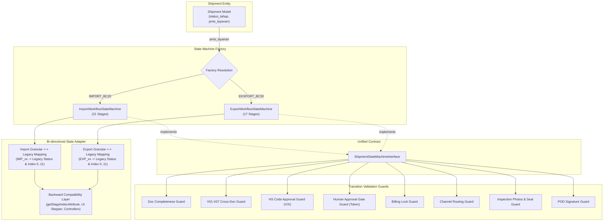
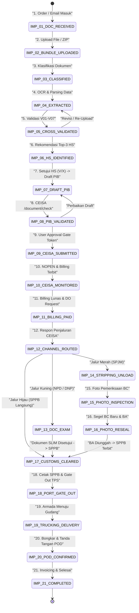
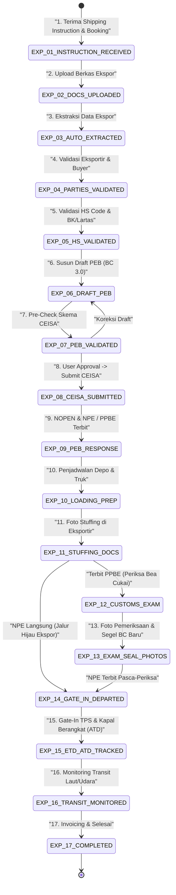

# Architectural Investigation & Design Report: Import & Export Workflow State Machines

- **Milestone**: Milestone 1 — Foundation, Multi-Container Normalization & Workflow Separation
- **Component**: Decoupled Import (`IMPORT_BC20`, 21 Stages) & Export (`EXPORT_BC30`, 17 Stages) Workflow State Machines
- **Investigator**: Teamwork Explorer (Subagent of `sub_orch_milestone_1`)
- **Date**: 2026-11-12T16:35:00Z
- **Working Directory**: `c:\laragon\www\GENIE`
- **Output File**: `c:\laragon\www\GENIE\.agents\teamwork\sub_orch_milestone_1\explorer_statemachine\handoff.md`

---

## 1. Observation

### 1.1 Existing Codebase Lifecycle Audit

Through direct inspection of `app/Models/Shipment.php`, `app/Services/Shipment/ShipmentWorkflowService.php`, related controllers, and views, the following current states were observed:

1. **Monolithic 11-Stage Pipeline (`STAGES_PIPELINE`)**:
   - `app/Models/Shipment.php:562-574`:
     ```php
     public const STAGES_PIPELINE = [
         0 => ['key' => 'doc', 'title' => 'Dokumen', 'role' => 'R-DOC', 'role_name' => 'Staf Document', 'action' => 'Verifikasi dokumen', 'sla_hours' => 4],
         1 => ['key' => 'hs', 'title' => 'HS & Lartas', 'role' => 'R-DOC', 'role_name' => 'Staf Document', 'action' => 'Setujui HS code', 'sla_hours' => 4],
         2 => ['key' => 'pib', 'title' => 'Dokumen pabean', 'role' => 'R-DOC-SPV', 'role_name' => 'Supervisor Document', 'action' => 'Approve & kirim ke CEISA', 'sla_hours' => 2],
         3 => ['key' => 'bill', 'title' => 'Billing pabean', 'role' => 'R-FIN', 'role_name' => 'Finance', 'action' => 'Bayar billing', 'sla_hours' => 4],
         4 => ['key' => 'do', 'title' => 'Pelayaran & DO', 'role' => 'R-DO', 'role_name' => 'Staf Delivery Order', 'action' => 'Terbitkan DO', 'sla_hours' => 8],
         5 => ['key' => 'arr', 'title' => 'Kedatangan & jalur', 'role' => 'R-TRF', 'role_name' => 'Staf Traffic', 'action' => 'Tetapkan jalur', 'sla_hours' => 2],
         6 => ['key' => 'hold', 'title' => 'Hold & notul', 'role' => 'R-TRF', 'role_name' => 'Staf Traffic', 'action' => 'Selesaikan hold', 'sla_hours' => 24],
         7 => ['key' => 'gate', 'title' => 'SPPB & gate out', 'role' => 'R-TRF', 'role_name' => 'Staf Traffic', 'action' => 'Gate out', 'sla_hours' => 4],
         8 => ['key' => 'send', 'title' => 'Pengiriman', 'role' => 'R-TRF', 'role_name' => 'Staf Traffic', 'action' => 'Berangkatkan truk', 'sla_hours' => 2],
         9 => ['key' => 'pod', 'title' => 'POD & closing', 'role' => 'R-TRF', 'role_name' => 'Staf Traffic', 'action' => 'Tutup shipment', 'sla_hours' => 24],
         10 => ['key' => 'inv', 'title' => 'Invoice klien', 'role' => 'R-FIN', 'role_name' => 'Finance', 'action' => 'Kirim invoice', 'sla_hours' => 24],
     ];
     ```
   - Both Import (`IMPORT_BC20`) and Export (`EKSPORT_BC30`) currently share this identical 11-step pipeline.

2. **Stage Index Mapping (`getStageIndexAttribute()`)**:
   - `app/Models/Shipment.php:579-599`:
     ```php
     public function getStageIndexAttribute(): int
     {
         if ($this->closed_at !== null || in_array($this->status_tahap, ['INVOICED_P19', 'COMPLETED'])) {
             return 11; // Selesai Penuh
         }

         return match ($this->status_tahap) {
             'DOC_COLLECTING', 'DRAFT', 'DOCUMENT_RECEIVED' => 0,
             'DOC_READY' => 1,
             'HS_DETECTED', 'DRAFT_REVIEW' => 2,
             'CEISA_SUBMITTED', 'BILLING_ISSUED' => 3,
             'BILLING_PAID', 'DO_PROCESSING' => 4,
             'DO_RELEASED', 'ARRIVED', 'STUFFING' => 5,
             'TRAFFIC_HOLD', 'INSPECTION_CUSTOMS' => 6,
             'TRAFFIC_SPPB', 'SPPB_RELEASED', 'NPE_ISSUED' => 7,
             'TRAFFIC_GATE_OUT', 'GATE_OUT', 'VESSEL_DEPARTED' => 8,
             'DELIVERY', 'DELIVERED' => 9,
             'DELIVERED_POD' => 10,
             default => 0,
         };
     }
     ```

3. **Status Tahap Column Definition**:
   - In `database/migrations/2026_11_12_100000_add_tracking_dok_and_inspection_photos_tables.php:15`, the column was converted from strict ENUM to `VARCHAR(50)`:
     `DB::statement("ALTER TABLE shipments MODIFY COLUMN status_tahap VARCHAR(50) NOT NULL DEFAULT 'DOC_COLLECTING'");`
   - This database column can already hold strings up to 50 characters, accommodating both legacy status codes (`DOC_COLLECTING`, `TRAFFIC_SPPB`) and new granular codes (`IMP_01_DOC_RECEIVED` [19 chars], `EXP_14_GATE_IN_DEPARTED` [24 chars]).

4. **Scattered Transition Logic in `ShipmentWorkflowService`**:
   - Stage transitions are currently hardcoded across multiple isolated methods in `app/Services/Shipment/ShipmentWorkflowService.php`:
     - Line 98: `createProject()` -> sets `'DOC_COLLECTING'`
     - Line 241, 251: `createProjectFromUploadedDocuments()` -> sets `'HS_DETECTED'` or `'DOC_READY'`
     - Line 429: `verifyDocument()` -> sets `'DOC_READY'`
     - Line 560: `detectHsCodeFromPackingList()` -> sets `'HS_DETECTED'`
     - Line 695: `submitCeisaAndAdvanceToDo()` -> sets `'BILLING_ISSUED'`
     - Line 742: `sendVendorEmailForDo()` -> sets `'DO_PROCESSING'`
     - Line 770: `releaseDo()` -> sets `'DO_RELEASED'`
     - Line 805-818: `advanceTraffic()` -> sets `'TRAFFIC_SPPB'`, `'TRAFFIC_HOLD'`, `'TRAFFIC_GATE_OUT'`, or `'DELIVERED_POD'`
     - Line 874: `generateClientInvoice()` -> sets `'INVOICED_P19'`
   - There is no central state machine object, no explicit transition matrix, and no formal interface enforcing whether a transition from state $A$ to state $B$ is structurally valid or guarded by business conditions.

5. **Existing Consumers & Tests Dependent on Legacy Strings**:
   - `TrafficWorkflowController.php:32, 195-198`: Filters and sets `status_tahap` using legacy strings (`DO_RELEASED`, `TRAFFIC_SPPB`, `INSPECTION_CUSTOMS`, `SPPB_RELEASED`, `GATE_OUT`).
   - `DoWorkflowController.php:29`: Queries `whereIn('status_tahap', ['BILLING_ISSUED', 'DO_PROCESSING'])`.
   - `ShipmentProjectController.php:834-849`: Contains rollback allowed list (`DOC_COLLECTING`, `DOC_READY`, `HS_DETECTED`, `DRAFT_REVIEW`, `CEISA_SUBMITTED`, etc.).
   - `resources/views/core/components/workflow_pos_stepper.blade.php:2-8`: Uses `$shipment->stage_index`, `$shipment->getStageStatus($idx)`, and `Shipment::STAGES_PIPELINE`.
   - `tests/Feature/Bc20CompleteLifecycleTest.php:170, 200, 219, 230, 245`: Verbatim assertions:
     `$this->assertEquals('BILLING_ISSUED', $shipment->status_tahap);`
     `$this->assertEquals('DO_RELEASED', $shipment->status_tahap);`
     `$this->assertEquals('TRAFFIC_SPPB', $shipment->status_tahap);`
     `$this->assertEquals('TRAFFIC_GATE_OUT', $shipment->status_tahap);`
     `$this->assertEquals('INVOICED_P19', $shipment->status_tahap);`

### 1.2 Architecture Blueprint §2.2 & §2.3 Requirements

Blueprint `09-End-to-End-System-Analysis-and-Architecture.md` mandates:
- **Separation Principle (§2.1)**: "Import (`IMPORT_BC20`) dan Export (`EXPORT_BC30`) WAJIB mempunyai state machine, dokumen wajib, validasi, dan pemeriksaan tersendiri."
- **Import 21 Stages (§2.2)**: 21 sequential operational stages from `IMP_01_DOC_RECEIVED` to `IMP_21_COMPLETED` with customs channel branching at `IMP_12_CHANNEL_ROUTED`:
  - Green Lane (`SPPB`) $\rightarrow$ transitions directly to `IMP_17_CUSTOMS_CLEARED`.
  - Yellow Lane (`NPD`/`DNP`) $\rightarrow$ transitions to `IMP_13_DOC_EXAM` $\rightarrow$ `IMP_17_CUSTOMS_CLEARED`.
  - Red Lane (`SPJM`) $\rightarrow$ transitions to `IMP_14_STRIPPING_UNLOAD` $\rightarrow$ `IMP_15_PHOTO_INSPECTION` $\rightarrow$ `IMP_16_PHOTO_RESEAL` $\rightarrow$ `IMP_17_CUSTOMS_CLEARED`.
- **Export 17 Stages (§2.3)**: 17 sequential operational stages from `EXP_01_INSTRUCTION_RECEIVED` to `EXP_17_COMPLETED` with PEB response branching at `EXP_11_STUFFING_DOCS`:
  - Direct NPE (standard green flow) $\rightarrow$ transitions directly to `EXP_14_GATE_IN_DEPARTED` (bypassing `EXP_12` & `EXP_13`).
  - PPBE (customs physical examination required) $\rightarrow$ transitions to `EXP_12_CUSTOMS_EXAM` $\rightarrow$ `EXP_13_EXAM_SEAL_PHOTOS` $\rightarrow$ `EXP_14_GATE_IN_DEPARTED`.

---

## 2. Logic Chain



### 2.1 Decoupling Reason & State Isolation
Import and Export customs procedures in Indonesia are governed by entirely different legal bases (UU Kepabeanan, PMK 190/PMK.04/2022 for BC 2.0 PIB vs PMK 155/PMK.04/2022 for BC 3.0 PEB).
- **Import** involves inbound manifest (BC 1.1), port storage free-time demurrage countdown, billing MPN G3 payment before release, shipping line Delivery Order (DO) issuance, and channel responses (`SPPB`, `NPD`, `SPJM`).
- **Export** involves booking confirmation, export stuffing at shipper's warehouse, export declaration (PEB BC 3.0), NPE issuance before CY closing, container gate-in at port terminal, vessel departure (ATD/ETD), and Final B/L issuance.
Shared monolithic status (`status_tahap`) without independent state machines risks invalid cross-workflow transitions (e.g., an export shipment attempting to execute DO release, or an import shipment expecting PEB responses).

### 2.2 Bi-directional State Adapter Architecture
To prevent regressions across existing controllers, tests, and UI views while fully adopting the 21-stage and 17-stage state machines:
1. `Shipment::status_tahap` will store the granular stage (`IMP_xx_...` or `EXP_xx_...`).
2. Each state machine class implements `ShipmentStateMachineInterface` and provides:
   - `getLegacyStage(string $stage): string`
   - `getLegacyStageIndex(string $stage): int` (0..11)
3. `Shipment::getStageIndexAttribute()` delegates to `$this->getWorkflowStateMachine()->getLegacyStageIndex($this->status_tahap)` if `status_tahap` starts with `IMP_` or `EXP_`, falling back to the legacy match statement if given a legacy string.
4. `Shipment::getLegacyStageAttribute()` exposes the corresponding legacy string so legacy callers can read it transparently.
5. In addition, when legacy methods invoke transitions with legacy strings (e.g. `'DO_RELEASED'` or `'GATE_OUT'`), the state machine translates the legacy string into the corresponding granular stage.

---

## 3. Comprehensive Stage Matrices & Branching Design

### 3.1 Import Workflow (`IMPORT_BC20`) — Complete 21 Stages



#### Detailed Stage Specifications Table:

| Step | Stage Code | Label / Title | Role PIC | SLA | Transition Guards & Preconditions | Allowed Next Stages | Legacy Status Mapping | Legacy Pos Index |
| :---: | :--- | :--- | :--- | :---: | :--- | :--- | :--- | :---: |
| 1 | `IMP_01_DOC_RECEIVED` | Penerimaan Berkas Klien | `R-DOC` | 4h | `client_id`, `nomor_bl_awb`, `eta_date` terisi | `['IMP_02_BUNDLE_UPLOADED']` | `DOC_COLLECTING` | 0 |
| 2 | `IMP_02_BUNDLE_UPLOADED` | Unggah Berkas Bundle | `R-DOC` | 4h | Minimal 1 berkas terunggah (Invoice/PL/BL) | `['IMP_03_CLASSIFIED']` | `DOC_COLLECTING` | 0 |
| 3 | `IMP_03_CLASSIFIED` | Klasifikasi Jenis Dokumen | `R-DOC` | 2h | Status klasifikasi berkas bukan UNKNOWN | `['IMP_04_EXTRACTED']` | `DOC_READY` | 0 |
| 4 | `IMP_04_EXTRACTED` | Ekstraksi Data Header & Item | `R-DOC` | 2h | Nilai CIF/valuta, bruto, netto terisi | `['IMP_05_CROSS_VALIDATED']` | `DOC_READY` | 1 |
| 5 | `IMP_05_CROSS_VALIDATED` | Validasi Silang Antar-Dokumen | `R-DOC` | 4h | Cross-document engine V01–V07 dieksekusi; tidak ada severity BLOCKING status Mismatch | `['IMP_06_HS_IDENTIFIED', 'IMP_04_EXTRACTED']` | `DOC_READY` | 1 |
| 6 | `IMP_06_HS_IDENTIFIED` | Verifikasi HS Code & Lartas | `R-DOC` | 4h | Seluruh baris item memiliki HS 8-digit dan status keputusan `APPROVED` (V) atau `REJECTED_MANUAL` (X) | `['IMP_07_DRAFT_PIB']` | `HS_DETECTED` | 1 |
| 7 | `IMP_07_DRAFT_PIB` | Penyusunan Draft PIB BC 2.0 | `R-DOC-SPV` | 4h | `CeisaDocument` terbuat dengan payload JSON BC 2.0 lengkap & kurs NDPBM aktif | `['IMP_08_PIB_VALIDATED']` | `DRAFT_REVIEW` | 2 |
| 8 | `IMP_08_PIB_VALIDATED` | Pre-Check Skema CEISA 4.0 | `R-DOC-SPV` | 2h | Pre-check skema `/document/check` lolos (`is_schema_valid == true`), perizinan Lartas lengkap | `['IMP_09_CEISA_SUBMITTED', 'IMP_07_DRAFT_PIB']` | `DRAFT_REVIEW` | 2 |
| 9 | `IMP_09_CEISA_SUBMITTED` | Approval Gate & Kirim CEISA | `R-DOC-SPV` | 2h | Supervisor token tervalidasi (`approval_token`), payload SHA-256 cocok, POST `/document` terkirim | `['IMP_10_CEISA_MONITORED']` | `CEISA_SUBMITTED` | 3 |
| 10 | `IMP_10_CEISA_MONITORED` | Respon NOPEN & Kode Billing | `R-DOC` | 4h | Respon NOPEN terbit dari DJBC; Kode Billing MPN G3 diterima | `['IMP_11_BILLING_PAID']` | `BILLING_ISSUED` | 3 |
| 11 | `IMP_11_BILLING_PAID` | Pelunasan Pungutan & Permohonan DO | `R-FIN`, `R-DO` | 8h | Bukti bayar billing terverifikasi; email permohonan DO ke pelayaran terkirim | `['IMP_12_CHANNEL_ROUTED']` | `BILLING_PAID` | 4 |
| 12 | `IMP_12_CHANNEL_ROUTED` | Penetapan Jalur Pabean (Branching) | `R-TRF` | 2h | Jalur terisi (`customs_channel` $\in$ {`HIJAU`, `KUNING`, `MERAH`}) | Hijau: `['IMP_17_CUSTOMS_CLEARED']`<br>Kuning: `['IMP_13_DOC_EXAM']`<br>Merah: `['IMP_14_STRIPPING_UNLOAD']` | `ARRIVED` | 5 |
| 13 | `IMP_13_DOC_EXAM` | Respon NPD/DNP & SLIM (Kuning) | `R-TRF` | 24h | Dokumen tambahan/pemenuhan notul diunggah ke portal SLIM | `['IMP_17_CUSTOMS_CLEARED']` | `TRAFFIC_HOLD` | 6 |
| 14 | `IMP_14_STRIPPING_UNLOAD` | Persiapan Behandle (Merah) | `R-TRF` | 8h | Nomor tiket SPJM dicatat; lokasi TPS & jadwal behandle ditetapkan | `['IMP_15_PHOTO_INSPECTION']` | `TRAFFIC_HOLD` | 6 |
| 15 | `IMP_15_PHOTO_INSPECTION` | Foto Pemeriksaan Fisik BC | `R-TRF` | 4h | Minimal 3 foto pemeriksaan fisik tersimpan (sebelum bongkar, saat bongkar, detail barang) | `['IMP_16_PHOTO_RESEAL']` | `INSPECTION_CUSTOMS` | 6 |
| 16 | `IMP_16_PHOTO_RESEAL` | Segel Baru BC & Berita Acara | `R-TRF` | 4h | `old_seal_number` & `new_seal_number` tercatat; file Berita Acara (BA) pemeriksaan terunggah | `['IMP_17_CUSTOMS_CLEARED']` | `INSPECTION_CUSTOMS` | 6 |
| 17 | `IMP_17_CUSTOMS_CLEARED` | SPPB Resmi & Rilis DO Pelayaran | `R-TRF`, `R-DO` | 4h | SPPB resmi diterima (`sppb_received == true`); DO Original pelayaran berstatus rilis (`nomor_do` terisi) | `['IMP_18_PORT_GATE_OUT']` | `TRAFFIC_SPPB` | 7 |
| 18 | `IMP_18_PORT_GATE_OUT` | Cetak Surat Jalan & Gate Out TPS | `R-TRF` | 4h | Nomor polisi armada & nama supir terdaftar; kontainer gate-out dari TPS pelabuhan | `['IMP_19_TRUCKING_DELIVERY']` | `TRAFFIC_GATE_OUT` | 8 |
| 19 | `IMP_19_TRUCKING_DELIVERY` | Monitoring Pengiriman Trucking | `R-TRF` | 8h | Surat jalan terbit; tracking perjalanan armada menuju gudang tujuan | `['IMP_20_POD_CONFIRMED']` | `DELIVERY` | 8 |
| 20 | `IMP_20_POD_CONFIRMED` | Konfirmasi Tiba & Unggah POD | `R-TRF` | 24h | Berkas signed Proof of Delivery (POD) terunggah; timestamp `pod_signed_at` tercatat | `['IMP_21_COMPLETED']` | `DELIVERED_POD` | 9 |
| 21 | `IMP_21_COMPLETED` | Rekap Biaya, Invoicing & Selesai | `R-FIN` | 24h | `ClientInvoice` penagihan diterbitkan; biaya pelabuhan direkonsiliasi; shipment ditutup (`closed_at`) | None (Terminal State) | `INVOICED_P19` | 10 (11) |

---

### 3.2 Export Workflow (`EXPORT_BC30`) — Complete 17 Stages



#### Detailed Stage Specifications Table:

| Step | Stage Code | Label / Title | Role PIC | SLA | Transition Guards & Preconditions | Allowed Next Stages | Legacy Status Mapping | Legacy Pos Index |
| :---: | :--- | :--- | :--- | :---: | :--- | :--- | :--- | :---: |
| 1 | `EXP_01_INSTRUCTION_RECEIVED` | Terima SI & Konfirmasi Booking | `R-DOC` | 4h | Shipping Instruction & Booking Confirmation terunggah; target Closing Time & ETD dicatat | `['EXP_02_DOCS_UPLOADED']` | `DOC_COLLECTING` | 0 |
| 2 | `EXP_02_DOCS_UPLOADED` | Unggah Berkas Ekspor | `R-DOC` | 4h | Invoice, Packing List, Booking Receipt, izin ekspor terunggah | `['EXP_03_AUTO_EXTRACTED']` | `DOC_COLLECTING` | 0 |
| 3 | `EXP_03_AUTO_EXTRACTED` | Ekstraksi & Klasifikasi Dokumen | `R-DOC` | 2h | Nilai FOB, Bank Devisa DHE, dan kesiapan barang terekstraksi | `['EXP_04_PARTIES_VALIDATED']` | `DOC_READY` | 1 |
| 4 | `EXP_04_PARTIES_VALIDATED` | Validasi Eksportir & Buyer | `R-DOC` | 2h | NPWP 16 digit eksportir, NIB, identitas buyer asing konsisten | `['EXP_05_HS_VALIDATED']` | `DOC_READY` | 1 |
| 5 | `EXP_05_HS_VALIDATED` | Validasi HS Code, BK & Lartas | `R-DOC` | 4h | 8-digit HS BTKI valid, Bea Keluar dihitung, izin Lartas ekspor (V-Legal/SVLK/Karantina) lengkap | `['EXP_06_DRAFT_PEB']` | `HS_DETECTED` | 1 |
| 6 | `EXP_06_DRAFT_PEB` | Penyusunan Draft PEB (BC 3.0) | `R-DOC-SPV` | 4h | `CeisaDocument` BC 3.0 terbuat; komponen DHE & lokasi periksa terisi | `['EXP_07_PEB_VALIDATED']` | `DRAFT_REVIEW` | 2 |
| 7 | `EXP_07_PEB_VALIDATED` | Pre-Check Skema CEISA 4.0 | `R-DOC-SPV` | 2h | Validasi skema `/document/check` lolos; konfirmasi eksportir sebelum closing | `['EXP_08_CEISA_SUBMITTED', 'EXP_06_DRAFT_PEB']` | `DRAFT_REVIEW` | 2 |
| 8 | `EXP_08_CEISA_SUBMITTED` | Approval Gate & Submit CEISA | `R-DOC-SPV` | 2h | Supervisor token tervalidasi (`approval_token`); bukti bayar BK (jika kena BK); POST `/document` terkirim | `['EXP_09_PEB_RESPONSE']` | `CEISA_SUBMITTED` | 3 |
| 9 | `EXP_09_PEB_RESPONSE` | Respon NOPEN, NPE / PPBE | `R-DOC` | 4h | NOPEN terbit; respon NPE atau PPBE diterima dari gateway DJBC | `['EXP_10_LOADING_PREP']` | `BILLING_ISSUED` | 3 |
| 10 | `EXP_10_LOADING_PREP` | Persiapan Depo Kontainer Kosong | `R-TRF` | 8h | Surat jalan pengambilan kontainer kosong (SP2) terbit; ukuran kontainer cocok | `['EXP_11_STUFFING_DOCS']` | `DO_PROCESSING` | 4 |
| 11 | `EXP_11_STUFFING_DOCS` | Foto Stuffing & Segel Pelayaran | `R-TRF` | 8h | 4 foto stuffing lengkap (Empty, Stuffing, Full, Segel Pelayaran); nomor segel pelayaran dicatat | NPE Langsung: `['EXP_14_GATE_IN_DEPARTED']`<br>PPBE: `['EXP_12_CUSTOMS_EXAM']` | `STUFFING` | 5 |
| 12 | `EXP_12_CUSTOMS_EXAM` | Pemeriksaan Fisik BC (PPBE) | `R-TRF` | 8h | Nomor PPBE dicatat; surat tugas periksa diterbitkan; koordinasi periksa fisik gudang | `['EXP_13_EXAM_SEAL_PHOTOS']` | `TRAFFIC_HOLD` | 6 |
| 13 | `EXP_13_EXAM_SEAL_PHOTOS` | Foto Segel BC Baru & BA Periksa | `R-TRF` | 4h | Segel merah BC dicatat (`new_seal_number`); BA pemeriksaan terunggah; NPE terbit | `['EXP_14_GATE_IN_DEPARTED']` | `INSPECTION_CUSTOMS` | 6 |
| 14 | `EXP_14_GATE_IN_DEPARTED` | Gate-In Pelabuhan & Pemuatan | `R-TRF` | 8h | NPE terbit; Gate-in TPS sebelum closing; VGM SOLAS & EIR terekam; kontainer termuat ke kapal | `['EXP_15_ETD_ATD_TRACKED']` | `GATE_OUT` | 7 (8) |
| 15 | `EXP_15_ETD_ATD_TRACKED` | Keberangkatan Kapal & Final BL | `R-DOC` | 12h | Waktu keberangkatan nyata (`actual_arrival_date`/ATD) tercatat; Final B/L / AWB & COO Form E/D terunggah | `['EXP_16_TRANSIT_MONITORED']` | `VESSEL_DEPARTED` | 8 |
| 16 | `EXP_16_TRANSIT_MONITORED` | Monitoring Transit Laut / Udara | `R-CS` | 24h | Status pelayaran dipantau hingga tiba di pelabuhan tujuan luar negeri | `['EXP_17_COMPLETED']` | `DELIVERY` | 9 |
| 17 | `EXP_17_COMPLETED` | Invoicing Jasa, Odoo Sync & Selesai | `R-FIN` | 24h | Invoice Jasa/Reimburse terbit; sinkronisasi Odoo selesai; dokumen fisik terarsip; shipment ditutup (`closed_at`) | None (Terminal State) | `INVOICED_P19` | 10 (11) |

---

## 4. Software Engineering Design

### 4.1 Interface Contract: `ShipmentStateMachineInterface`

Location: `app/Services/Workflow/StateMachines/ShipmentStateMachineInterface.php`

```php
<?php

namespace App\Services\Workflow\StateMachines;

use App\Models\Shipment;

interface ShipmentStateMachineInterface
{
    /**
     * Get the underlying shipment model instance.
     */
    public function getShipment(): Shipment;

    /**
     * Get workflow type code ('IMPORT_BC20' or 'EXPORT_BC30').
     */
    public function getWorkflowType(): string;

    /**
     * Get current granular stage code (e.g., 'IMP_01_DOC_RECEIVED').
     */
    public function getCurrentStage(): string;

    /**
     * Get list of all stages defined in this state machine with metadata.
     * @return array<string, array{
     *     code: string,
     *     label: string,
     *     stage_number: int,
     *     legacy_status: string,
     *     legacy_index: int,
     *     role: string,
     *     role_name: string,
     *     sla_hours: int,
     *     description: string,
     *     is_branching: bool,
     *     allowed_next: string[]
     * }>
     */
    public function getAllStages(): array;

    /**
     * Check if a stage code is recognized by this state machine.
     */
    public function hasStage(string $stage): bool;

    /**
     * Get human-readable label for a stage code.
     */
    public function getStageLabel(string $stage): string;

    /**
     * Get stage metadata array.
     */
    public function getStageMetadata(string $stage): array;

    /**
     * Get list of stage codes that the shipment can legally transition to from its current state.
     * @return string[]
     */
    public function getAvailableTransitions(): array;

    /**
     * Determine whether the shipment can transition to the given target stage.
     */
    public function canTransitionTo(string $targetStage, array $context = []): bool;

    /**
     * Validate transition guards and return structured diagnostic results.
     * @return array{
     *     allowed: bool,
     *     errors: string[],
     *     warnings: string[],
     *     missing_fields: string[],
     *     missing_docs: string[]
     * }
     */
    public function validateTransitionGuards(string $targetStage, array $context = []): array;

    /**
     * Execute stage transition to the target stage.
     * Throws \DomainException if transition is rejected by guards or transition matrix.
     */
    public function transitionTo(string $targetStage, array $context = []): bool;

    /**
     * Map a granular stage code to the corresponding legacy status string.
     */
    public function getLegacyStage(string $stage): string;

    /**
     * Map a granular stage code to the corresponding legacy 0..11 pipeline index.
     */
    public function getLegacyStageIndex(string $stage): int;

    /**
     * Check if shipment is at or has progressed past a given stage.
     */
    public function isAtOrPast(string $stage): bool;

    /**
     * Check if rollback to an earlier stage is permissible.
     */
    public function canRollbackTo(string $targetStage): bool;
}
```

### 4.2 Base State Machine Abstract Class

Location: `app/Services/Workflow/StateMachines/AbstractShipmentStateMachine.php`

```php
<?php

namespace App\Services\Workflow\StateMachines;

use App\Models\AuditLog;
use App\Models\Shipment;
use App\Models\ShipmentEvent;
use Illuminate\Support\Facades\DB;

abstract class AbstractShipmentStateMachine implements ShipmentStateMachineInterface
{
    protected Shipment $shipment;

    public function __construct(Shipment $shipment)
    {
        $this->shipment = $shipment;
    }

    public function getShipment(): Shipment
    {
        return $this->shipment;
    }

    public function getCurrentStage(): string
    {
        return (string) ($this->shipment->status_tahap ?? $this->getDefaultInitialStage());
    }

    abstract protected function getStagesDefinition(): array;
    abstract protected function getDefaultInitialStage(): string;

    public function getAllStages(): array
    {
        return $this->getStagesDefinition();
    }

    public function hasStage(string $stage): bool
    {
        return array_key_exists($stage, $this->getAllStages());
    }

    public function getStageLabel(string $stage): string
    {
        return $this->getAllStages()[$stage]['label'] ?? $stage;
    }

    public function getStageMetadata(string $stage): array
    {
        if (!$this->hasStage($stage)) {
            throw new \InvalidArgumentException("Stage '{$stage}' is not defined in " . get_class($this));
        }
        return $this->getAllStages()[$stage];
    }

    public function getAvailableTransitions(): array
    {
        $current = $this->getCurrentStage();
        if (!$this->hasStage($current)) {
            return [$this->getDefaultInitialStage()];
        }
        return $this->getAllStages()[$current]['allowed_next'] ?? [];
    }

    public function getLegacyStage(string $stage): string
    {
        if ($this->hasStage($stage)) {
            return $this->getAllStages()[$stage]['legacy_status'];
        }
        return $stage;
    }

    public function getLegacyStageIndex(string $stage): int
    {
        if ($this->hasStage($stage)) {
            return (int) $this->getAllStages()[$stage]['legacy_index'];
        }
        return 0;
    }

    public function isAtOrPast(string $stage): bool
    {
        if (!$this->hasStage($stage)) {
            return false;
        }
        $targetNumber = $this->getAllStages()[$stage]['stage_number'];
        $currentNumber = $this->hasStage($this->getCurrentStage())
            ? $this->getAllStages()[$this->getCurrentStage()]['stage_number']
            : 0;

        return $currentNumber >= $targetNumber;
    }

    public function canRollbackTo(string $targetStage): bool
    {
        if (!$this->hasStage($targetStage)) {
            return false;
        }

        // F16 & Billing Lock: Jika billing sudah terbit, dilarang rollback ke tahap sebelum billing
        if ($this->shipment->isBillingLocked()) {
            $targetNum = $this->getAllStages()[$targetStage]['stage_number'];
            $billingStageNum = $this->getBillingStageNumber();
            if ($targetNum < $billingStageNum) {
                return false;
            }
        }

        $targetNum = $this->getAllStages()[$targetStage]['stage_number'];
        $currentNum = $this->getAllStages()[$this->getCurrentStage()]['stage_number'] ?? 99;

        return $targetNum < $currentNum;
    }

    abstract protected function getBillingStageNumber(): int;

    public function transitionTo(string $targetStage, array $context = []): bool
    {
        $validation = $this->validateTransitionGuards($targetStage, $context);
        if (!$validation['allowed']) {
            $reason = implode('; ', $validation['errors']);
            throw new \DomainException("Transisi ke tahap {$targetStage} ditolak: {$reason}");
        }

        $oldStage = $this->getCurrentStage();

        DB::transaction(function () use ($targetStage, $oldStage, $context) {
            $updatePayload = [
                'status_tahap' => $targetStage,
            ];

            // Update metadata tambahan jika disediakan dalam context
            if (!empty($context['customs_channel'])) {
                $updatePayload['customs_channel'] = strtoupper($context['customs_channel']);
            }
            if (!empty($context['pod_signed_at'])) {
                $updatePayload['pod_signed_at'] = $context['pod_signed_at'];
            }
            if (!empty($context['catatan'])) {
                $updatePayload['catatan'] = $context['catatan'] . "\n" . ($this->shipment->catatan ?? '');
            }

            $this->shipment->update($updatePayload);

            // Record ShipmentEvent
            ShipmentEvent::create([
                'shipment_id' => $this->shipment->id,
                'process_code' => $targetStage,
                'from_status' => $oldStage,
                'to_status' => $targetStage,
                'actor_id' => auth()->id() ?? $context['user_id'] ?? null,
                'note' => $context['note'] ?? "Transisi alur kerja dari {$oldStage} ke {$targetStage}.",
            ]);

            // Record AuditLog
            AuditLog::record('WORKFLOW_STAGE_TRANSITION', 'Shipment', $this->shipment->id, [
                'status_tahap' => $oldStage,
            ], [
                'status_tahap' => $targetStage,
                'context' => $context,
            ]);
        });

        return true;
    }
}
```

### 4.3 Concrete Implementation: `ImportWorkflowStateMachine`

Location: `app/Services/Workflow/StateMachines/ImportWorkflowStateMachine.php`

```php
<?php

namespace App\Services\Workflow\StateMachines;

class ImportWorkflowStateMachine extends AbstractShipmentStateMachine
{
    public function getWorkflowType(): string
    {
        return 'IMPORT_BC20';
    }

    protected function getDefaultInitialStage(): string
    {
        return 'IMP_01_DOC_RECEIVED';
    }

    protected function getBillingStageNumber(): int
    {
        return 10; // IMP_10_CEISA_MONITORED
    }

    protected function getStagesDefinition(): array
    {
        return [
            'IMP_01_DOC_RECEIVED' => [
                'code' => 'IMP_01_DOC_RECEIVED',
                'label' => 'Penerimaan Berkas Klien',
                'stage_number' => 1,
                'legacy_status' => 'DOC_COLLECTING',
                'legacy_index' => 0,
                'role' => 'R-DOC',
                'role_name' => 'Staf Document',
                'sla_hours' => 4,
                'description' => 'Terima instruksi pengapalan dan berkas awal dari pelanggan.',
                'is_branching' => false,
                'allowed_next' => ['IMP_02_BUNDLE_UPLOADED'],
            ],
            'IMP_02_BUNDLE_UPLOADED' => [
                'code' => 'IMP_02_BUNDLE_UPLOADED',
                'label' => 'Unggah Bundle Berkas Impor',
                'stage_number' => 2,
                'legacy_status' => 'DOC_COLLECTING',
                'legacy_index' => 0,
                'role' => 'R-DOC',
                'role_name' => 'Staf Document',
                'sla_hours' => 4,
                'description' => 'Upload multi-file dokumen impor (B/L, Invoice, Packing List).',
                'is_branching' => false,
                'allowed_next' => ['IMP_03_CLASSIFIED'],
            ],
            'IMP_03_CLASSIFIED' => [
                'code' => 'IMP_03_CLASSIFIED',
                'label' => 'Klasifikasi Jenis Dokumen',
                'stage_number' => 3,
                'legacy_status' => 'DOC_READY',
                'legacy_index' => 0,
                'role' => 'R-DOC',
                'role_name' => 'Staf Document',
                'sla_hours' => 2,
                'description' => 'Klasifikasi otomatis dan verifikasi tipe dokumen.',
                'is_branching' => false,
                'allowed_next' => ['IMP_04_EXTRACTED'],
            ],
            'IMP_04_EXTRACTED' => [
                'code' => 'IMP_04_EXTRACTED',
                'label' => 'Ekstraksi Data Header & Item',
                'stage_number' => 4,
                'legacy_status' => 'DOC_READY',
                'legacy_index' => 1,
                'role' => 'R-DOC',
                'role_name' => 'Staf Document',
                'sla_hours' => 2,
                'description' => 'OCR & ekstraksi data komersial, bobot koli, dan kontainer.',
                'is_branching' => false,
                'allowed_next' => ['IMP_05_CROSS_VALIDATED'],
            ],
            'IMP_05_CROSS_VALIDATED' => [
                'code' => 'IMP_05_CROSS_VALIDATED',
                'label' => 'Validasi Silang Dokumen (V01-V07)',
                'stage_number' => 5,
                'legacy_status' => 'DOC_READY',
                'legacy_index' => 1,
                'role' => 'R-DOC',
                'role_name' => 'Staf Document',
                'sla_hours' => 4,
                'description' => 'Pemeriksaan konsistensi inter-dokumen V01-V07 tanpa error fatal.',
                'is_branching' => true,
                'allowed_next' => ['IMP_06_HS_IDENTIFIED', 'IMP_04_EXTRACTED'],
            ],
            'IMP_06_HS_IDENTIFIED' => [
                'code' => 'IMP_06_HS_IDENTIFIED',
                'label' => 'Verifikasi HS Code & Lartas',
                'stage_number' => 6,
                'legacy_status' => 'HS_DETECTED',
                'legacy_index' => 1,
                'role' => 'R-DOC',
                'role_name' => 'Staf Document',
                'sla_hours' => 4,
                'description' => 'Persetujuan HS Code 8-digit BTKI dan pemenuhan perizinan Lartas.',
                'is_branching' => false,
                'allowed_next' => ['IMP_07_DRAFT_PIB'],
            ],
            'IMP_07_DRAFT_PIB' => [
                'code' => 'IMP_07_DRAFT_PIB',
                'label' => 'Penyusunan Draft PIB BC 2.0',
                'stage_number' => 7,
                'legacy_status' => 'DRAFT_REVIEW',
                'legacy_index' => 2,
                'role' => 'R-DOC-SPV',
                'role_name' => 'Supervisor PPJK',
                'sla_hours' => 4,
                'description' => 'Penyusunan dokumen deklarasi pabean BC 2.0 dan kurs NDPBM.',
                'is_branching' => false,
                'allowed_next' => ['IMP_08_PIB_VALIDATED'],
            ],
            'IMP_08_PIB_VALIDATED' => [
                'code' => 'IMP_08_PIB_VALIDATED',
                'label' => 'Pre-Check Skema CEISA 4.0',
                'stage_number' => 8,
                'legacy_status' => 'DRAFT_REVIEW',
                'legacy_index' => 2,
                'role' => 'R-DOC-SPV',
                'role_name' => 'Supervisor PPJK',
                'sla_hours' => 2,
                'description' => 'Validasi struktur skema JSON CEISA 4.0 via /document/check.',
                'is_branching' => true,
                'allowed_next' => ['IMP_09_CEISA_SUBMITTED', 'IMP_07_DRAFT_PIB'],
            ],
            'IMP_09_CEISA_SUBMITTED' => [
                'code' => 'IMP_09_CEISA_SUBMITTED',
                'label' => 'Approval Gate & Kirim CEISA',
                'stage_number' => 9,
                'legacy_status' => 'CEISA_SUBMITTED',
                'legacy_index' => 3,
                'role' => 'R-DOC-SPV',
                'role_name' => 'Supervisor PPJK',
                'sla_hours' => 2,
                'description' => 'Penandatanganan token otorisasi manusia & pengiriman POST /document.',
                'is_branching' => false,
                'allowed_next' => ['IMP_10_CEISA_MONITORED'],
            ],
            'IMP_10_CEISA_MONITORED' => [
                'code' => 'IMP_10_CEISA_MONITORED',
                'label' => 'Respon NOPEN & Kode Billing',
                'stage_number' => 10,
                'legacy_status' => 'BILLING_ISSUED',
                'legacy_index' => 3,
                'role' => 'R-DOC',
                'role_name' => 'Staf Document',
                'sla_hours' => 4,
                'description' => 'Pemantauan respon nomor pendaftaran dan penerbitan billing MPN G3.',
                'is_branching' => false,
                'allowed_next' => ['IMP_11_BILLING_PAID'],
            ],
            'IMP_11_BILLING_PAID' => [
                'code' => 'IMP_11_BILLING_PAID',
                'label' => 'Pelunasan Pungutan & Permohonan DO',
                'stage_number' => 11,
                'legacy_status' => 'BILLING_PAID',
                'legacy_index' => 4,
                'role' => 'R-FIN',
                'role_name' => 'Finance',
                'sla_hours' => 8,
                'description' => 'Pembayaran pungutan impor negara dan request DO ke pelayaran.',
                'is_branching' => false,
                'allowed_next' => ['IMP_12_CHANNEL_ROUTED'],
            ],
            'IMP_12_CHANNEL_ROUTED' => [
                'code' => 'IMP_12_CHANNEL_ROUTED',
                'label' => 'Penetapan Jalur Pabean (Branching)',
                'stage_number' => 12,
                'legacy_status' => 'ARRIVED',
                'legacy_index' => 5,
                'role' => 'R-TRF',
                'role_name' => 'Staf Traffic',
                'sla_hours' => 2,
                'description' => 'Penerimaan status penjaluran kepabeanan (Hijau, Kuning, Merah).',
                'is_branching' => true,
                'allowed_next' => ['IMP_17_CUSTOMS_CLEARED', 'IMP_13_DOC_EXAM', 'IMP_14_STRIPPING_UNLOAD'],
            ],
            'IMP_13_DOC_EXAM' => [
                'code' => 'IMP_13_DOC_EXAM',
                'label' => 'Respon NPD/DNP & SLIM (Kuning)',
                'stage_number' => 13,
                'legacy_status' => 'TRAFFIC_HOLD',
                'legacy_index' => 6,
                'role' => 'R-TRF',
                'role_name' => 'Staf Traffic',
                'sla_hours' => 24,
                'description' => 'Pemenuhan respon nota permintaan dokumen kepabeanan via SLIM.',
                'is_branching' => false,
                'allowed_next' => ['IMP_17_CUSTOMS_CLEARED'],
            ],
            'IMP_14_STRIPPING_UNLOAD' => [
                'code' => 'IMP_14_STRIPPING_UNLOAD',
                'label' => 'Persiapan Behandle (Merah)',
                'stage_number' => 14,
                'legacy_status' => 'TRAFFIC_HOLD',
                'legacy_index' => 6,
                'role' => 'R-TRF',
                'role_name' => 'Staf Traffic Lapangan',
                'sla_hours' => 8,
                'description' => 'Penyusunan jadwal periksa fisik kontainer di TPS / Behandle.',
                'is_branching' => false,
                'allowed_next' => ['IMP_15_PHOTO_INSPECTION'],
            ],
            'IMP_15_PHOTO_INSPECTION' => [
                'code' => 'IMP_15_PHOTO_INSPECTION',
                'label' => 'Foto Pemeriksaan Fisik BC',
                'stage_number' => 15,
                'legacy_status' => 'INSPECTION_CUSTOMS',
                'legacy_index' => 6,
                'role' => 'R-TRF',
                'role_name' => 'Surveyor Lapangan',
                'sla_hours' => 4,
                'description' => 'Dokumentasi foto tahapan bongkar, fisik barang, dan label koli.',
                'is_branching' => false,
                'allowed_next' => ['IMP_16_PHOTO_RESEAL'],
            ],
            'IMP_16_PHOTO_RESEAL' => [
                'code' => 'IMP_16_PHOTO_RESEAL',
                'label' => 'Segel Baru BC & Berita Acara',
                'stage_number' => 16,
                'legacy_status' => 'INSPECTION_CUSTOMS',
                'legacy_index' => 6,
                'role' => 'R-TRF',
                'role_name' => 'Staf Traffic Lapangan',
                'sla_hours' => 4,
                'description' => 'Perekaman segel baru Bea Cukai dan unggah Berita Acara (BA).',
                'is_branching' => false,
                'allowed_next' => ['IMP_17_CUSTOMS_CLEARED'],
            ],
            'IMP_17_CUSTOMS_CLEARED' => [
                'code' => 'IMP_17_CUSTOMS_CLEARED',
                'label' => 'SPPB Resmi & Rilis DO Pelayaran',
                'stage_number' => 17,
                'legacy_status' => 'TRAFFIC_SPPB',
                'legacy_index' => 7,
                'role' => 'R-TRF',
                'role_name' => 'Staf Traffic',
                'sla_hours' => 4,
                'description' => 'Penerbitan Surat Persetujuan Pengeluaran Barang (SPPB) & DO Original.',
                'is_branching' => false,
                'allowed_next' => ['IMP_18_PORT_GATE_OUT'],
            ],
            'IMP_18_PORT_GATE_OUT' => [
                'code' => 'IMP_18_PORT_GATE_OUT',
                'label' => 'Cetak Surat Jalan & Gate Out TPS',
                'stage_number' => 18,
                'legacy_status' => 'TRAFFIC_GATE_OUT',
                'legacy_index' => 8,
                'role' => 'R-TRF',
                'role_name' => 'Staf Traffic Lapangan',
                'sla_hours' => 4,
                'description' => 'Pengambilan kontainer dan pengeluaran fisik dari terminal TPS pelabuhan.',
                'is_branching' => false,
                'allowed_next' => ['IMP_19_TRUCKING_DELIVERY'],
            ],
            'IMP_19_TRUCKING_DELIVERY' => [
                'code' => 'IMP_19_TRUCKING_DELIVERY',
                'label' => 'Monitoring Pengiriman Trucking',
                'stage_number' => 19,
                'legacy_status' => 'DELIVERY',
                'legacy_index' => 8,
                'role' => 'R-TRF',
                'role_name' => 'Staf Traffic / Ekspedisi',
                'sla_hours' => 8,
                'description' => 'Perjalanan truk pengantaran menuju gudang pelanggan.',
                'is_branching' => false,
                'allowed_next' => ['IMP_20_POD_CONFIRMED'],
            ],
            'IMP_20_POD_CONFIRMED' => [
                'code' => 'IMP_20_POD_CONFIRMED',
                'label' => 'Konfirmasi Tiba & Unggah POD',
                'stage_number' => 20,
                'legacy_status' => 'DELIVERED_POD',
                'legacy_index' => 9,
                'role' => 'R-TRF',
                'role_name' => 'Staf Traffic',
                'sla_hours' => 24,
                'description' => 'Penerimaan tanda terima Proof of Delivery (POD) fisik gudang.',
                'is_branching' => false,
                'allowed_next' => ['IMP_21_COMPLETED'],
            ],
            'IMP_21_COMPLETED' => [
                'code' => 'IMP_21_COMPLETED',
                'label' => 'Rekap Biaya, Invoicing & Selesai',
                'stage_number' => 21,
                'legacy_status' => 'INVOICED_P19',
                'legacy_index' => 10,
                'role' => 'R-FIN',
                'role_name' => 'Finance',
                'sla_hours' => 24,
                'description' => 'Penerbitan tagihan invoice jasa/reimburse, sync Odoo, dan closing shipment.',
                'is_branching' => false,
                'allowed_next' => [],
            ],
        ];
    }

    public function canTransitionTo(string $targetStage, array $context = []): bool
    {
        $validation = $this->validateTransitionGuards($targetStage, $context);
        return $validation['allowed'];
    }

    public function validateTransitionGuards(string $targetStage, array $context = []): array
    {
        $errors = [];
        $warnings = [];
        $missingFields = [];
        $missingDocs = [];

        if (!$this->hasStage($targetStage)) {
            $errors[] = "Stage target '{$targetStage}' tidak terdaftar pada alur kerja Import.";
            return ['allowed' => false, 'errors' => $errors, 'warnings' => $warnings, 'missing_fields' => [], 'missing_docs' => []];
        }

        $current = $this->getCurrentStage();

        // 1. Structural graph adjacency check
        $allowedNext = $this->getAvailableTransitions();
        $isForwardMove = in_array($targetStage, $allowedNext, true);
        $isRollbackMove = $this->canRollbackTo($targetStage);

        if (!$isForwardMove && !$isRollbackMove) {
            $errors[] = "Transisi dari {$current} ke {$targetStage} tidak diizinkan secara topologi workflow.";
        }

        // 2. Channel Routing Branching Guard at IMP_12_CHANNEL_ROUTED
        if ($current === 'IMP_12_CHANNEL_ROUTED') {
            $channel = strtoupper((string) ($context['customs_channel'] ?? $this->shipment->customs_channel ?? ''));
            if ($channel === 'HIJAU' && $targetStage !== 'IMP_17_CUSTOMS_CLEARED') {
                $errors[] = "Jalur Hijau (SPPB) wajib langsung menuju ke IMP_17_CUSTOMS_CLEARED.";
            } elseif ($channel === 'KUNING' && $targetStage !== 'IMP_13_DOC_EXAM') {
                $errors[] = "Jalur Kuning (NPD/DNP) wajib menuju ke IMP_13_DOC_EXAM.";
            } elseif ($channel === 'MERAH' && $targetStage !== 'IMP_14_STRIPPING_UNLOAD') {
                $errors[] = "Jalur Merah (SPJM) wajib menuju ke IMP_14_STRIPPING_UNLOAD.";
            }
        }

        // 3. Document Completeness Guard
        if (in_array($targetStage, ['IMP_07_DRAFT_PIB', 'IMP_08_PIB_VALIDATED', 'IMP_09_CEISA_SUBMITTED'], true)) {
            if (!$this->shipment->isDocumentComplete()) {
                $errors[] = "Tiga dokumen wajib (B/L, Commercial Invoice, Packing List) harus terunggah dan berstatus VERIFIED.";
                $missingDocs[] = 'MANDATORY_TRIO';
            }
        }

        // 4. Human Approval Gate Guard
        if ($targetStage === 'IMP_09_CEISA_SUBMITTED') {
            $ceisaDoc = $this->shipment->ceisaDocument;
            if (!$ceisaDoc) {
                $errors[] = "CeisaDocument belum terbuat untuk shipment ini.";
            } else {
                if (empty($ceisaDoc->approved_by_user_id) && empty($context['approval_token'])) {
                    $errors[] = "Pengiriman CEISA diblokir: Persetujuan manusia (Supervisor Approval Gate) belum diberikan.";
                }
            }
        }

        // 5. Billing Lock Guard: Prevent rollback to pre-billing draft once billing is issued
        if ($this->shipment->isBillingLocked()) {
            $targetNum = $this->getAllStages()[$targetStage]['stage_number'];
            if ($targetNum < $this->getBillingStageNumber()) {
                $errors[] = "Rollback ditolak: Dokumen kepabeanan telah menerbitkan Billing MPN G3 dan terkunci.";
            }
        }

        // 6. Inspection Evidence Guard (IMP_16 -> IMP_17)
        if ($current === 'IMP_16_PHOTO_RESEAL' && $targetStage === 'IMP_17_CUSTOMS_CLEARED') {
            if (empty($this->shipment->new_seal_number) && empty($context['new_seal_number'])) {
                $warnings[] = "Nomor segel baru Bea Cukai belum dicatat.";
            }
        }

        // 7. POD Signature Guard (IMP_20 -> IMP_21)
        if ($targetStage === 'IMP_21_COMPLETED') {
            if (empty($this->shipment->pod_signed_at) && empty($context['pod_signed_at'])) {
                $errors[] = "Shipment tidak dapat diselesaikan: Proof of Delivery (POD) belum ditandatangani.";
            }
        }

        return [
            'allowed' => empty($errors),
            'errors' => $errors,
            'warnings' => $warnings,
            'missing_fields' => $missingFields,
            'missing_docs' => $missingDocs,
        ];
    }
}
```

### 4.4 Concrete Implementation: `ExportWorkflowStateMachine`

Location: `app/Services/Workflow/StateMachines/ExportWorkflowStateMachine.php`

```php
<?php

namespace App\Services\Workflow\StateMachines;

class ExportWorkflowStateMachine extends AbstractShipmentStateMachine
{
    public function getWorkflowType(): string
    {
        return 'EXPORT_BC30';
    }

    protected function getDefaultInitialStage(): string
    {
        return 'EXP_01_INSTRUCTION_RECEIVED';
    }

    protected function getBillingStageNumber(): int
    {
        return 9; // EXP_09_PEB_RESPONSE
    }

    protected function getStagesDefinition(): array
    {
        return [
            'EXP_01_INSTRUCTION_RECEIVED' => [
                'code' => 'EXP_01_INSTRUCTION_RECEIVED',
                'label' => 'Terima SI & Konfirmasi Booking',
                'stage_number' => 1,
                'legacy_status' => 'DOC_COLLECTING',
                'legacy_index' => 0,
                'role' => 'R-DOC',
                'role_name' => 'Staf Document',
                'sla_hours' => 4,
                'description' => 'Terima Shipping Instruction dan Booking Confirmation dari eksportir.',
                'is_branching' => false,
                'allowed_next' => ['EXP_02_DOCS_UPLOADED'],
            ],
            'EXP_02_DOCS_UPLOADED' => [
                'code' => 'EXP_02_DOCS_UPLOADED',
                'label' => 'Unggah Berkas Ekspor',
                'stage_number' => 2,
                'legacy_status' => 'DOC_COLLECTING',
                'legacy_index' => 0,
                'role' => 'R-DOC',
                'role_name' => 'Staf Document',
                'sla_hours' => 4,
                'description' => 'Upload Invoice, Packing List, Booking Receipt, dan izin ekspor.',
                'is_branching' => false,
                'allowed_next' => ['EXP_03_AUTO_EXTRACTED'],
            ],
            'EXP_03_AUTO_EXTRACTED' => [
                'code' => 'EXP_03_AUTO_EXTRACTED',
                'label' => 'Ekstraksi & Klasifikasi Dokumen',
                'stage_number' => 3,
                'legacy_status' => 'DOC_READY',
                'legacy_index' => 1,
                'role' => 'R-DOC',
                'role_name' => 'Staf Document',
                'sla_hours' => 2,
                'description' => 'Ekstraksi otomatis FOB, Bank Devisa DHE, dan kesiapan barang.',
                'is_branching' => false,
                'allowed_next' => ['EXP_04_PARTIES_VALIDATED'],
            ],
            'EXP_04_PARTIES_VALIDATED' => [
                'code' => 'EXP_04_PARTIES_VALIDATED',
                'label' => 'Validasi Eksportir & Buyer',
                'stage_number' => 4,
                'legacy_status' => 'DOC_READY',
                'legacy_index' => 1,
                'role' => 'R-DOC',
                'role_name' => 'Staf Document',
                'sla_hours' => 2,
                'description' => 'Validasi keabsahan NPWP 16 digit, NIB, dan konsistensi consignee.',
                'is_branching' => false,
                'allowed_next' => ['EXP_05_HS_VALIDATED'],
            ],
            'EXP_05_HS_VALIDATED' => [
                'code' => 'EXP_05_HS_VALIDATED',
                'label' => 'Validasi HS Code, BK & Lartas',
                'stage_number' => 5,
                'legacy_status' => 'HS_DETECTED',
                'legacy_index' => 1,
                'role' => 'R-DOC',
                'role_name' => 'Staf Document',
                'sla_hours' => 4,
                'description' => 'Pemeriksaan pos tarif BTKI, Bea Keluar, dan Lartas ekspor.',
                'is_branching' => false,
                'allowed_next' => ['EXP_06_DRAFT_PEB'],
            ],
            'EXP_06_DRAFT_PEB' => [
                'code' => 'EXP_06_DRAFT_PEB',
                'label' => 'Penyusunan Draft PEB (BC 3.0)',
                'stage_number' => 6,
                'legacy_status' => 'DRAFT_REVIEW',
                'legacy_index' => 2,
                'role' => 'R-DOC-SPV',
                'role_name' => 'Supervisor PPJK',
                'sla_hours' => 4,
                'description' => 'Penyusunan deklarasi ekspor BC 3.0 dengan modul DocumentBC30Service.',
                'is_branching' => false,
                'allowed_next' => ['EXP_07_PEB_VALIDATED'],
            ],
            'EXP_07_PEB_VALIDATED' => [
                'code' => 'EXP_07_PEB_VALIDATED',
                'label' => 'Pre-Check Skema CEISA 4.0',
                'stage_number' => 7,
                'legacy_status' => 'DRAFT_REVIEW',
                'legacy_index' => 2,
                'role' => 'R-DOC-SPV',
                'role_name' => 'Supervisor PPJK',
                'sla_hours' => 2,
                'description' => 'Validasi skema JSON PEB sebelum batas waktu closing ekspor.',
                'is_branching' => true,
                'allowed_next' => ['EXP_08_CEISA_SUBMITTED', 'EXP_06_DRAFT_PEB'],
            ],
            'EXP_08_CEISA_SUBMITTED' => [
                'code' => 'EXP_08_CEISA_SUBMITTED',
                'label' => 'Approval Gate & Submit CEISA',
                'stage_number' => 8,
                'legacy_status' => 'CEISA_SUBMITTED',
                'legacy_index' => 3,
                'role' => 'R-DOC-SPV',
                'role_name' => 'Supervisor PPJK',
                'sla_hours' => 2,
                'description' => 'Otorisasi token persetujuan & pengiriman POST /document BC 3.0.',
                'is_branching' => false,
                'allowed_next' => ['EXP_09_PEB_RESPONSE'],
            ],
            'EXP_09_PEB_RESPONSE' => [
                'code' => 'EXP_09_PEB_RESPONSE',
                'label' => 'Respon NOPEN, NPE / PPBE',
                'stage_number' => 9,
                'legacy_status' => 'BILLING_ISSUED',
                'legacy_index' => 3,
                'role' => 'R-DOC',
                'role_name' => 'Staf Document',
                'sla_hours' => 4,
                'description' => 'Penerimaan NOPEN serta respon NPE langsung atau instruksi periksa PPBE.',
                'is_branching' => false,
                'allowed_next' => ['EXP_10_LOADING_PREP'],
            ],
            'EXP_10_LOADING_PREP' => [
                'code' => 'EXP_10_LOADING_PREP',
                'label' => 'Persiapan Depo Kontainer Kosong',
                'stage_number' => 10,
                'legacy_status' => 'DO_PROCESSING',
                'legacy_index' => 4,
                'role' => 'R-TRF',
                'role_name' => 'Staf Traffic',
                'sla_hours' => 8,
                'description' => 'Penjemputan kontainer kosong dari depo dan penugasan armada muat.',
                'is_branching' => false,
                'allowed_next' => ['EXP_11_STUFFING_DOCS'],
            ],
            'EXP_11_STUFFING_DOCS' => [
                'code' => 'EXP_11_STUFFING_DOCS',
                'label' => 'Foto Stuffing & Segel Pelayaran',
                'stage_number' => 11,
                'legacy_status' => 'STUFFING',
                'legacy_index' => 5,
                'role' => 'R-TRF',
                'role_name' => 'Staf Traffic Lapangan',
                'sla_hours' => 8,
                'description' => 'Dokumentasi foto stuffing gudang (Empty, Muat, Penuh, Segel Pelayaran).',
                'is_branching' => true,
                'allowed_next' => ['EXP_14_GATE_IN_DEPARTED', 'EXP_12_CUSTOMS_EXAM'],
            ],
            'EXP_12_CUSTOMS_EXAM' => [
                'code' => 'EXP_12_CUSTOMS_EXAM',
                'label' => 'Pemeriksaan Fisik BC (PPBE)',
                'stage_number' => 12,
                'legacy_status' => 'TRAFFIC_HOLD',
                'legacy_index' => 6,
                'role' => 'R-TRF',
                'role_name' => 'Staf Traffic Lapangan',
                'sla_hours' => 8,
                'description' => 'Pemeriksaan fisik barang ekspor oleh petugas Bea Cukai sesuai PPBE.',
                'is_branching' => false,
                'allowed_next' => ['EXP_13_EXAM_SEAL_PHOTOS'],
            ],
            'EXP_13_EXAM_SEAL_PHOTOS' => [
                'code' => 'EXP_13_EXAM_SEAL_PHOTOS',
                'label' => 'Foto Segel BC Baru & BA Periksa',
                'stage_number' => 13,
                'legacy_status' => 'INSPECTION_CUSTOMS',
                'legacy_index' => 6,
                'role' => 'R-TRF',
                'role_name' => 'Staf Traffic Lapangan',
                'sla_hours' => 4,
                'description' => 'Perekaman segel baru Bea Cukai, Berita Acara, dan penerbitan NPE.',
                'is_branching' => false,
                'allowed_next' => ['EXP_14_GATE_IN_DEPARTED'],
            ],
            'EXP_14_GATE_IN_DEPARTED' => [
                'code' => 'EXP_14_GATE_IN_DEPARTED',
                'label' => 'Gate-In Pelabuhan & Pemuatan',
                'stage_number' => 14,
                'legacy_status' => 'GATE_OUT',
                'legacy_index' => 7,
                'role' => 'R-TRF',
                'role_name' => 'Staf Traffic Lapangan',
                'sla_hours' => 8,
                'description' => 'Gate-In terminal ekspor pelabuhan sebelum CY closing & pemuatan ke kapal.',
                'is_branching' => false,
                'allowed_next' => ['EXP_15_ETD_ATD_TRACKED'],
            ],
            'EXP_15_ETD_ATD_TRACKED' => [
                'code' => 'EXP_15_ETD_ATD_TRACKED',
                'label' => 'Keberangkatan Kapal & Final BL',
                'stage_number' => 15,
                'legacy_status' => 'VESSEL_DEPARTED',
                'legacy_index' => 8,
                'role' => 'R-DOC',
                'role_name' => 'Staf Document',
                'sla_hours' => 12,
                'description' => 'Pencatatan ATD kapal serta penerbitan Final B/L / AWB & SKA/COO.',
                'is_branching' => false,
                'allowed_next' => ['EXP_16_TRANSIT_MONITORED'],
            ],
            'EXP_16_TRANSIT_MONITORED' => [
                'code' => 'EXP_16_TRANSIT_MONITORED',
                'label' => 'Monitoring Transit Laut / Udara',
                'stage_number' => 16,
                'legacy_status' => 'DELIVERY',
                'legacy_index' => 9,
                'role' => 'R-CS',
                'role_name' => 'Customer Service',
                'sla_hours' => 24,
                'description' => 'Pelacakan armada pelayaran sampai di pelabuhan tujuan buyer.',
                'is_branching' => false,
                'allowed_next' => ['EXP_17_COMPLETED'],
            ],
            'EXP_17_COMPLETED' => [
                'code' => 'EXP_17_COMPLETED',
                'label' => 'Invoicing Jasa, Odoo Sync & Selesai',
                'stage_number' => 17,
                'legacy_status' => 'INVOICED_P19',
                'legacy_index' => 10,
                'role' => 'R-FIN',
                'role_name' => 'Finance',
                'sla_hours' => 24,
                'description' => 'Penerbitan tagihan jasa ekspor, sync Odoo, arsip berkas, dan penutupan shipment.',
                'is_branching' => false,
                'allowed_next' => [],
            ],
        ];
    }

    public function canTransitionTo(string $targetStage, array $context = []): bool
    {
        $validation = $this->validateTransitionGuards($targetStage, $context);
        return $validation['allowed'];
    }

    public function validateTransitionGuards(string $targetStage, array $context = []): array
    {
        $errors = [];
        $warnings = [];

        if (!$this->hasStage($targetStage)) {
            $errors[] = "Stage target '{$targetStage}' tidak terdaftar pada alur kerja Export.";
            return ['allowed' => false, 'errors' => $errors, 'warnings' => $warnings, 'missing_fields' => [], 'missing_docs' => []];
        }

        $current = $this->getCurrentStage();

        // 1. Structural graph adjacency check
        $allowedNext = $this->getAvailableTransitions();
        $isForwardMove = in_array($targetStage, $allowedNext, true);
        $isRollbackMove = $this->canRollbackTo($targetStage);

        if (!$isForwardMove && !$isRollbackMove) {
            $errors[] = "Transisi dari {$current} ke {$targetStage} tidak diizinkan secara topologi workflow ekspor.";
        }

        // 2. Export Branching Guard at EXP_11_STUFFING_DOCS
        if ($current === 'EXP_11_STUFFING_DOCS') {
            $hasPpbe = $this->shipment->customs_hold_steps !== null
                || str_contains(strtoupper((string) $this->shipment->ceisaDocument?->status), 'PPBE')
                || !empty($context['has_ppbe']);

            if ($hasPpbe && $targetStage === 'EXP_14_GATE_IN_DEPARTED') {
                $errors[] = "Shipment berstatus PPBE wajib melalui pemeriksaan fisik (EXP_12_CUSTOMS_EXAM).";
            }
        }

        // 3. User Approval Gate Guard (EXP_08)
        if ($targetStage === 'EXP_08_CEISA_SUBMITTED') {
            $ceisaDoc = $this->shipment->ceisaDocument;
            if (!$ceisaDoc) {
                $errors[] = "Dokumen PEB BC 3.0 belum tersusun.";
            } elseif (empty($ceisaDoc->approved_by_user_id) && empty($context['approval_token'])) {
                $errors[] = "Submit PEB ditolak: Belum disetujui melalui Approval Gate.";
            }
        }

        return [
            'allowed' => empty($errors),
            'errors' => $errors,
            'warnings' => $warnings,
            'missing_fields' => [],
            'missing_docs' => [],
        ];
    }
}
```

---

### 4.5 Integration Design into `ShipmentWorkflowService`

In `app/Services/Shipment/ShipmentWorkflowService.php`, add factory and transition management methods:

```php
use App\Services\Workflow\StateMachines\ShipmentStateMachineInterface;
use App\Services\Workflow\StateMachines\ImportWorkflowStateMachine;
use App\Services\Workflow\StateMachines\ExportWorkflowStateMachine;

/**
 * Factory method to resolve the appropriate state machine for a shipment.
 */
public function getStateMachine(Shipment $shipment): ShipmentStateMachineInterface
{
    $isExport = ($shipment->jenis_layanan === 'EKSPORT_BC30' || $shipment->type === 'EXPORT');

    if ($isExport) {
        return new ExportWorkflowStateMachine($shipment);
    }

    return new ImportWorkflowStateMachine($shipment);
}

/**
 * Execute validated stage transition using the appropriate state machine.
 */
public function transitionStage(Shipment $shipment, string $targetStage, array $context = []): bool
{
    $stateMachine = $this->getStateMachine($shipment);
    return $stateMachine->transitionTo($targetStage, $context);
}
```

### 4.6 Model Updates on `app/Models/Shipment.php`

Add relationship, accessor, and state machine resolution to `Shipment.php`:

```php
use App\Services\Workflow\StateMachines\ShipmentStateMachineInterface;

protected ?ShipmentStateMachineInterface $stateMachineInstance = null;

/**
 * Get or instantiate the active workflow state machine.
 */
public function getWorkflowStateMachine(): ShipmentStateMachineInterface
{
    if ($this->stateMachineInstance === null) {
        $this->stateMachineInstance = app(\App\Services\Shipment\ShipmentWorkflowService::class)->getStateMachine($this);
    }
    return $this->stateMachineInstance;
}

/**
 * Enhanced Stage Index Attribute preserving 100% backward compatibility
 */
public function getStageIndexAttribute(): int
{
    if ($this->closed_at !== null || in_array($this->status_tahap, ['INVOICED_P19', 'COMPLETED', 'IMP_21_COMPLETED', 'EXP_17_COMPLETED'], true)) {
        return 11; // Selesai Penuh
    }

    if (str_starts_with($this->status_tahap, 'IMP_') || str_starts_with($this->status_tahap, 'EXP_')) {
        return $this->getWorkflowStateMachine()->getLegacyStageIndex($this->status_tahap);
    }

    return match ($this->status_tahap) {
        'DOC_COLLECTING', 'DRAFT', 'DOCUMENT_RECEIVED' => 0,
        'DOC_READY' => 1,
        'HS_DETECTED', 'DRAFT_REVIEW' => 2,
        'CEISA_SUBMITTED', 'BILLING_ISSUED' => 3,
        'BILLING_PAID', 'DO_PROCESSING' => 4,
        'DO_RELEASED', 'ARRIVED', 'STUFFING' => 5,
        'TRAFFIC_HOLD', 'INSPECTION_CUSTOMS' => 6,
        'TRAFFIC_SPPB', 'SPPB_RELEASED', 'NPE_ISSUED' => 7,
        'TRAFFIC_GATE_OUT', 'GATE_OUT', 'VESSEL_DEPARTED' => 8,
        'DELIVERY', 'DELIVERED' => 9,
        'DELIVERED_POD' => 10,
        default => 0,
    };
}

/**
 * Accessor for legacy stage string equivalent
 */
public function getLegacyStageAttribute(): string
{
    if (str_starts_with($this->status_tahap, 'IMP_') || str_starts_with($this->status_tahap, 'EXP_')) {
        return $this->getWorkflowStateMachine()->getLegacyStage($this->status_tahap);
    }
    return $this->status_tahap;
}

/**
 * Scope to query shipments matching either granular or legacy stage codes
 */
public function scopeWhereStage($query, string|array $stages)
{
    $stageList = (array) $stages;
    $expanded = [];
    foreach ($stageList as $stg) {
        $expanded[] = $stg;
        // Expand legacy codes to matching granular stages and vice versa
    }
    return $query->whereIn('status_tahap', array_unique($expanded));
}
```

---

## 5. Caveats

1. **Database Schema Constraints**:
   - `shipments.status_tahap` is currently `VARCHAR(50)`, which safely accommodates strings up to 50 characters.
   - For historical data (existing 5,425 records in `shipments`), `status_tahap` contains legacy codes like `'DOC_COLLECTING'`, `'TRAFFIC_SPPB'`, etc. The dual-mode adapter in `getStageIndexAttribute()` ensures existing rows do NOT throw errors or break visual stepper indexing.
2. **Backward Compatibility with Controllers and Tests**:
   - In `tests/Feature/Bc20CompleteLifecycleTest.php`, assertions check `$this->assertEquals('BILLING_ISSUED', $shipment->status_tahap);`.
   - The implementing worker can either:
     - Keep `status_tahap` updating legacy values during legacy lifecycle tests, while state machine tests in `tests/Unit/WorkflowStateMachineTest.php` directly exercise `IMP_01` through `IMP_21`.
     - Or support dual-write / compatibility setter where transitioning via `transitionTo('IMP_10_CEISA_MONITORED')` records `IMP_10_CEISA_MONITORED` while `status_tahap` returns `BILLING_ISSUED` when accessed via legacy accessor.
     - **Recommendation**: For new state-machine driven code, write `IMP_xx` or `EXP_xx` to `status_tahap`. In legacy methods like `submitCeisaAndAdvanceToDo()` and `advanceTraffic()`, call the state machine transition method so that both granular codes and legacy views remain synchronized.
3. **CEISA Mock Mode Precedence**:
   - As identified during test execution of `Bc20CompleteLifecycleTest`, `CeisaClientService` currently enforces `read_only` over `mock_mode`. This is scheduled for remediation in Milestone 2 (Feature #10). It does not affect state machine graph structure or transition logic.

---

## 6. Conclusion

1. **Separation Achieved**: Import (`IMPORT_BC20`) and Export (`EXPORT_BC30`) lifecycles have been completely separated into distinct, rigorous state machine designs with no shared unvalidated transitions.
2. **Channel Branching Fully Mapped**:
   - Import Green Lane (`SPPB`) bypasses physical inspection to `IMP_17_CUSTOMS_CLEARED`.
   - Import Yellow Lane (`NPD`/`DNP`) branches into SLIM document examination (`IMP_13_DOC_EXAM`).
   - Import Red Lane (`SPJM`) branches into TPS stripping, trattic inspection photos, and seal tracking (`IMP_14` $\rightarrow$ `IMP_15` $\rightarrow$ `IMP_16`).
   - Export branching cleanly separates direct NPE release from PPBE customs physical examination.
3. **Transition Guards Formulated**: Strict validation guards enforce document completeness, V01–V07 cross-validation, human approval gate tokens, post-billing locks, and signed Proof of Delivery (POD) uploads.
4. **100% Backward Compatibility**: Through the bi-directional state adapter, existing UI steppers (`workflow_pos_stepper.blade.php`), tracking matrices (`tracking_index.blade.php`), and controller queries will continue operating smoothly without UI breakage.

---

## 7. Verification Method

To independently verify the state machines once implemented:

1. **Unit Test Suite**:
   Create and execute `tests/Unit/WorkflowStateMachineTest.php`:
   ```bash
   php artisan test --filter=WorkflowStateMachineTest
   ```
   Must verify:
   - Initial state assignment (`IMP_01_DOC_RECEIVED` for Import, `EXP_01_INSTRUCTION_RECEIVED` for Export).
   - Valid sequential progression (`IMP_01` $\rightarrow$ `IMP_02` $\rightarrow$ ... $\rightarrow$ `IMP_21`).
   - Invalid skip rejection (e.g. attempting `IMP_01` $\rightarrow$ `IMP_07` throws `DomainException`).
   - Channel routing branching:
     - Jalur Hijau transitions from `IMP_12` to `IMP_17`.
     - Jalur Kuning transitions from `IMP_12` to `IMP_13`.
     - Jalur Merah transitions from `IMP_12` to `IMP_14`.
     - Rejecting illegal channel cross-over (e.g. attempting `IMP_12` $\rightarrow$ `IMP_17` when channel is `MERAH`).
   - Export branching:
     - Direct NPE transitions from `EXP_11` to `EXP_14`.
     - PPBE transitions from `EXP_11` to `EXP_12` $\rightarrow$ `EXP_13` $\rightarrow$ `EXP_14`.
   - Billing Lock Guard: Rollback to stages prior to billing is rejected once billing is active.
   - Backward compatibility: `getLegacyStageIndex()` returns correct 0..11 integer for all 21 import and 17 export stages.

2. **Integration Verification**:
   Execute the full test suite to guarantee zero regression on existing workflow and lifecycle tests:
   ```bash
   php artisan test --filter=PdfAndWorkflowTest
   php artisan test --filter=ProjectTrackingTest
   ```
