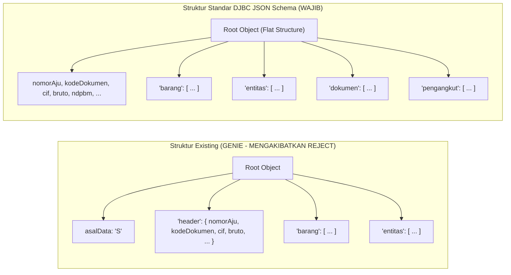

# LAPORAN HASIL AUDIT KESENJANGAN (GAP ANALYSIS)
## Integrasi Open API CEISA 4.0 DJBC vs Sistem PATS_CEISA (GENIE)
**PT AGUNG TRANS SOLUSINDO**  
*Tanggal Audit: 19 Oktober 2026*  
*Klasifikasi: Laporan Audit Arsitektur & Kepatuhan Sistem Kepabeanan*  
*Rujukan Regulasi: JSON Schema Kirim Dokumen Pabean DJBC (BC 2.0 v.0.5.7.23 & BC 3.0 v.0.5.29) & Developer Portal DJBC*

---

## 1. Ringkasan Eksekutif

Audit teknis dilakukan untuk mengevaluasi kesiapan arsitektur sistem **PATS_CEISA** pada repositori `c:\laragon\www\GENIE` dalam melakukan integrasi *Host-to-Host* (H2H) secara langsung ke **API Gateway CEISA 4.0 Direktorat Jenderal Bea dan Cukai (DJBC)**.

Evaluasi difokuskan pada 2 (dua) dokumen utama kepabeanan:
1. **BC 2.0 (Pemberitahuan Impor Barang - PIB)** — Schema versi `v.0.5.7.23`
2. **BC 3.0 (Pemberitahuan Ekspor Barang - PEB)** — Schema versi `v.0.5.29`

Serta 6 (enam) katalog layanan Open API DJBC yang terdaftar pada *Developer Portal* (`openapi.beacukai.go.id`).

> [!CAUTION]
> **TEMUAN AUDIT KRITIS (SHOWSTOPPER / BLOCKING ISSUE):**  
> Sistem existing saat ini **100% TIDAK DAPAT DITERIMA** oleh gateway resmi CEISA 4.0. Seluruh pengiriman dokumen BC 2.0 maupun BC 3.0 akan langsung ditolak (*Error 400 Bad Request / Schema Validation Failed*) karena adanya **kesalahan fatal pada struktur payload**: sistem existing membungkus data header dalam obyek bersarang `['header']`, sedangkan standar skema DJBC mewajibkan struktur **Flat Object di Root Level**.

---

## 2. Inventarisasi & Pemetaan Katalog Open API CEISA 4.0

Berdasarkan inspeksi langsung terhadap portal pengembang resmi DJBC, berikut pemetaan 6 UUID API Gateway terhadap kebutuhan operasional sistem PATS_CEISA:

| No | UUID Developer Portal | Nama API | Versi | Base Endpoint Gateway | Status di Sistem Existing | Keterangan & Rekomendasi |
| :---: | :--- | :--- | :---: | :--- | :---: | :--- |
| **1** | `5b212cfd-e7d7-48d8-9fd6-0012863c9cb0` | **`openapi-auth`** | `v1` | `https://apis-gw.beacukai.go.id/v1/openapi-auth` | **Parsial** | Telah mengimplementasikan `POST /user/login`, namun **belum** mengimplementasikan endpoint pembaruan token `POST /user/update-token`. |
| **2** | `3e2ab2ad-31bc-4bb3-be29-5086bd49d3af` | **`openapi` (Pabean)** | `v2.0` | `https://apis-gw.beacukai.go.id/v2/openapi` | **Salah Rute & Skema** | Menggunakan endpoint usang `/pabean/v1/dokumen`. Wajib dialihkan ke `POST /document`, `POST /document/check`, dan `GET /status/{nomorAju}`. |
| **3** | `60f76364-9668-42da-b801-0c95527b9069` | **`openapi-manifes`** | `v1` | `https://apis-gw.beacukai.go.id/v1/openapi-manifes` | **Belum Terhubung** | Belum ada integrasi untuk pre-validasi data pos BC 1.1 Inward/Outward Manifes kapal. |
| **4** | `92505fb1-951c-4eff-ba36-2df4dd91cc42` | **`openapi-tps`** | `v1` | `https://apis-gw.beacukai.go.id/v1/openapi-tpsonline` | **Belum Terhubung** | Tim Traffic masih mencatat status rilis kontainer/SPPB dan Gate Out secara manual tanpa memanfaatkan feed data TPS Online H2H. |
| **5** | `f74ab8c3-258a-4195-971a-a5f408c57bf6` | **`openapi-cukai`** | `v1` | `https://apis-gw.beacukai.go.id/v1/openapi-cukai` | **Tidak Relevan** | Khusus produsen/pabrik etil alkohol, MMEA, dan tembakau (bukan lingkup forwarder umum). |
| **6** | `54e39783-35a1-4b2e-8d30-5ca663b78a2f` | **`openapi-xray-upload`**| `v1.0` | `https://apis-gw.beacukai.go.id/v1/openapi-xray-upload` | **Belum Terhubung** | Khusus kargo barang kiriman / peti kemas pemindaian x-ray. |

---

## 3. Analisis Kesenjangan Arsitektural (Root Level vs Nested "header")

### 3.1 Perbandingan Struktur Data



### 3.2 Bukti Kode Sumber Existing
Pada `app/Services/Ceisa/DocumentBC20Service.php` (baris 122–146) dan `DocumentBC30Service.php` (baris 97–120):
```php
// Existing: Menaruh field wajib di dalam array bersarang 'header'
return [
    'asalData' => 'S',
    'header' => [
        'nomorAju' => $nomorAju,
        'kodeDokumen' => '20',
        'cif' => $cif,
        'ndbm' => $kurs,
        ...
    ],
    'entitas' => [ ... ],
    'barang' => [ ... ]
];
```
### 3.3 Spesifikasi Resmi DJBC
Skema JSON DJBC menetapkan bahwa seluruh properti header berada langsung di bawah obyek akar (*root properties*). Validator JSON Schema DJBC akan memeriksa `required: ["asuransi", "bruto", "cif", "nomorAju", ...]` pada tingkat terluar. Keberadaan key `'header'` menyebabkan seluruh atribut tersebut terbaca sebagai `null` atau `undefined`.

---

## 4. Analisis Detail Kesenjangan Dokumen BC 2.0 (Impor / PIB)

| Kategori Elemen | Field Resmi DJBC | Status Existing | Keterangan & Rincian Kesenjangan |
| :--- | :--- | :---: | :--- |
| **Manifes BC 1.1** | `nomorBc11`<br>`tanggalBc11`<br>`posBc11`<br>`subposBc11`<br>`kodeTutupPu` | ❌ **Hilang Total** | **GAP KRITIS.** Setiap dokumen PIB wajib merujuk pada nomor pos manifest kedatangan kapal/pesawat. `kodeTutupPu` wajib bernilai `11` (BC 1.1), `12` (BC 1.2), atau `14` (BC 1.4). |
| **Lokasi Bongkar** | `kodeTps` | ❌ **Hilang Total** | Wajib kode TPS terdaftar di kantor pabean tujuan (contoh: `TPS1`, `KOJA`, `JICT`). |
| **Waktu Kedatangan** | `tanggalTiba` | ❌ **Hilang Total** | Wajib diisi tanggal estimasi kedatangan sarana pengangkut (`YYYY-MM-DD`). |
| **Komponen Biaya** | `biayaTambahan`<br>`biayaPengurang` | ❌ **Hilang Total** | Masuk ke dalam array `required` pada skema BC 2.0. Jika tidak ada, wajib diisi nilai numerik `0`. |
| **Penandatangan** | `namaTtd`<br>`jabatanTtd`<br>`kotaTtd`<br>`tanggalTtd` | ❌ **Hilang Total** | Wajib mencantumkan data pihak penanggung jawab pengajuan pabean (PPJK / Importir). |
| **Valuasi Barang** | `metodePenentuanNilai`<br>`alasanMetodePenentuanNilai`<br>`statementPerbedaanHarga`<br>`barangVd` | ❌ **Hilang Total** | Setiap baris barang wajib menyatakan metode penentuan nilai pabean (Metode 1 s.d. 6), pernyataan perbedaan harga (`Y`/`T`), dan array *Voluntary Declaration* (`barangVd`). |
| **Pungutan & Fasilitas** | `kodeFasilitasTarif`<br>`tarifFasilitas`<br>`nilaiFasilitas` | ⚠️ **Parsial** | Sub-array `barangTarif` hanya mengisi tarif dan nilai bayar, belum menyertakan fasilitas pembebasan / preferensi tarif FTA. |
| **Entitas Terlibat** | `kodeEntitas: "7"` (Pemilik)<br>`kodeAfiliasi`<br>`kodeEntitas: "10"` (Penjual)<br>`kodeJenisApi` | ⚠️ **Parsial** | Existing hanya mengirim Importir (`1`) dan Supplier (`9`). Pemilik barang (`7`) wajib ada beserta kode afiliasi (`AFL`, `CTR`, `FAM`, `TAH`). Importir wajib mendeklarasikan jenis API (`01` API-U / `02` API-P). |

---

## 5. Analisis Detail Kesenjangan Dokumen BC 3.0 (Ekspor / PEB)

| Kategori Elemen | Field Resmi DJBC | Status Existing | Keterangan & Rincian Kesenjangan |
| :--- | :--- | :---: | :--- |
| **Kesiapan Barang** | `kesiapanBarang` (Array) | ❌ **Hilang Total** | **GAP KRITIS.** Masuk dalam array `required` skema BC 3.0. Wajib memuat data Pemeriksaan Kesiapan Barang (PKB): `kodeJenisGudang`, `namaPic`, `alamat`, `nomorTelpPic`, `lokasiSiapPeriksa`, `tanggalPkb`, dan `waktuSiapPeriksa` (ISO 8601). |
| **Devisa Ekspor** | `bankDevisa` (Array) | ❌ **Hilang Total** | **GAP KRITIS.** Masuk dalam array `required` skema BC 3.0. Wajib memuat `kodeBank`, `namaBank`, dan `seriBank` untuk kepatuhan Devisa Hasil Ekspor (DHE). |
| **Pengawasan Ekspor** | `kodeKantorEkspor`<br>`kodeKantorMuat`<br>`kodeKantorPeriksa` | ⚠️ **Parsial** | Existing hanya menyertakan 1 `kodeKantor`. BC 3.0 memisahkan kantor pemuatan, kantor pendaftaran ekspor, dan kantor pemeriksaan. |
| **Flag Perlakuan** | `flagBarkir`<br>`flagCurah`<br>`flagMigas` | ❌ **Hilang Total** | Wajib deklarasi barang kiriman (`Y`/`T`), flag curah (`1`/`2`), dan flag migas (`1`/`2`). |
| **Penandatangan** | `namaTtd`<br>`jabatanTtd`<br>`kotaTtd`<br>`tanggalTtd` | ❌ **Hilang Total** | Identitas pembuat dokumen ekspor wajib ada. |
| **Entitas Perdagangan** | `kodeEntitas: "6"` (Pembeli)<br>`kodeEntitas: "8"` (Penerima)<br>`kodeEntitas: "7"` (Pemilik) | ❌ **Keliru Kodifikasi** | Existing mencatat pembeli luar negeri dengan kode `8` (Penerima). Sesuai standar DJBC: Pembeli adalah kode `6`, Penerima adalah kode `8`, dan Pemilik adalah kode `7`. |

---

## 6. Matriks Inkonsistensi Penamaan Variabel (Naming Mismatch)

Berikut adalah ketidaksesuaian penamaan kunci (*property key*) antara kode Laravel existing dengan skema resmi:

| Entitas Data | Key di Kode Existing | Key Resmi DJBC JSON Schema | Konsekuensi Validasi |
| :--- | :--- | :--- | :--- |
| **Kurs Valuta KMK** | `ndbm` / `ndbm_kurs` | **`ndpbm`** | Ditolak (Nilai NDPBM dianggap 0/hilang) |
| **Pelabuhan Muat (BC 2.0)** | `kodePelabuhanMuat` | **`kodePelMuat`** | Ditolak (*Required field missing*) |
| **Pelabuhan Tujuan (BC 2.0)**| `kodePelabuhanTujuan` | **`kodePelTujuan`** | Ditolak (*Required field missing*) |
| **Pelabuhan Muat (BC 3.0)** | `kodePelabuhanMuatEkspor` | **`kodePelMuat`** & **`kodePelEkspor`** | Ditolak (*Required field missing*) |
| **Nomor Induk Berusaha** | `nib` | **`nibEntitas`** | Data NIB entitas tidak tersimpan di DJBC |
| **Merek Kemasan** | `merekKemasan` | **`merkKemasan`** | Ditolak (*Required field missing*) |
| **Merek Barang** | `merk` (min 2 char) | **`merk`** (min 2 char) | Sesuai, namun perlu validasi minlength |

---

## 7. Analisis Rute Endpoint Gateway & Protokol Keamanan

1. **Rute Endpoint Kirim Dokumen:**
   * **Existing (`config/ceisa.php` baris 42):** Mengarah ke `https://apis-dev.beacukai.go.id/pabean/v1/dokumen`
   * **Standar Open API CEISA 4.0 v2:** Wajib mengarah ke **`https://apis-gw.beacukai.go.id/v2/openapi/document`**
2. **Ketiadaan Fitur Validasi Skema Mandiri (`/document/check`):**
   * DJBC menyediakan endpoint `POST /v2/openapi/document/check` untuk mengecek validitas JSON schema tanpa memotong kuota pengajuan dan tanpa menerbitkan penolakan resmi. Fitur ini belum dimanfaatkan oleh sistem existing.
3. **Endpoint Status & Respon Dokumen:**
   * **Existing:** Memecah status ke `/pabean/v1/status-dokumen` dan `/pabean/v1/respon-dokumen`.
   * **Standar Open API:** Cukup memanggil endpoint terpadu **`GET /v2/openapi/status/{nomorAju}`** yang mengembalikan array `dataStatus` (status alur dokumen) dan `dataRespon` (dokumen resmi terbit seperti Billing MPN G3, SPPB, NPE, atau dokumen PDF Base64).
4. **Manajemen Masa Berlaku Token (Lifecycle):**
   * Token autentikasi CEISA 4.0 memiliki batas kedaluwarsa (~5 menit). Sistem existing melakukan login ulang dengan `username` dan `password` setiap token habis.
   * Standard Open API menyediakan endpoint **`POST /user/update-token`** yang lebih ringan, cepat, dan sesuai dengan protokol gateway DJBC.

---

## 8. Matriks Evaluasi Tingkat Risiko Teknis

| Komponen Terdampak | Tingkat Risiko | Potensi Kegagalan Operasional |
| :--- | :---: | :--- |
| **Struktur Root Payload** | **CRITICAL (10/10)** | Seluruh pengiriman dokumen pabean gagal total pada lapis gateway. |
| **Kelengkapan BC 1.1 (Impor)** | **CRITICAL (10/10)** | Kontainer impor tertahan di pelabuhan karena PIB tidak terhubung ke manifes kapal. |
| **Kesiapan Barang & Bank Devisa (Ekspor)** | **CRITICAL (10/10)** | Barang ekspor tidak dapat dilakukan pemeriksaan kesiapan (PKB) dan melanggar ketentuan DHE. |
| **Inkonsistensi Nomenklatur Key** | **HIGH (8/10)** | Field vital seperti kurs, pelabuhan, dan NIB terabaikan oleh parser sistem pabean. |
| **Endpoint Gateway Outdated** | **HIGH (8/10)** | Request mengarah ke URL usang yang berpotensi ditutup atau tidak mendukung skema v2. |
| **Ketiadaan Pre-Check Schema** | **MEDIUM (6/10)** | Kesalahan ketik atau format baru diketahui setelah submit resmi (berisiko tercatat reject di audit DJBC). |

---

## 9. Kesimpulan Audit

Sistem PATS_CEISA pada repositori GENIE telah memiliki fondasi bisnis dan model database yang solid (mencakup pencatatan `raw_payload`, `last_response`, tracking alur P01–P19, dan role RBAC). Namun, **pada lapisan integrasi pertukaran data (*payload contract & gateway layer*)**, terdapat kesenjangan mendasar antara implementasi saat ini dengan spesifikasi resmi CEISA 4.0 Open API DJBC.

Perbaikan mendesak wajib dilakukan pada level *Payload Builder Services*, *Form UI Inputs*, *Configuration Endpoints*, dan *Client Gateway Service* sebelum sistem dihubungkan ke lingkungan produksi atau sandbox resmi DJBC.
