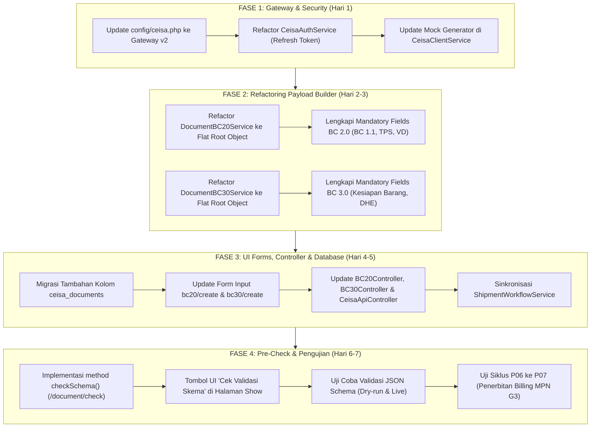

# RENCANA AKSI IMPLEMENTASI & MIGRASI TEKNIS
## Penyelarasan Sistem PATS_CEISA (GENIE) ke Standar Open API CEISA 4.0 DJBC
**PT AGUNG TRANS SOLUSINDO**  
*Tanggal Dokumen: 19 Oktober 2026*  
*Versi Dokumen: 1.0 (Final Blueprint)*  
*Target Dokumen: BC 2.0 (PIB v.0.5.7.23) & BC 3.0 (PEB v.0.5.29)*

---

## 1. Pendahuluan & Sasaran Strategis

Dokumen ini memuat **panduan langkah demi langkah (*actionable execution plan*)** untuk menutup seluruh temuan kesenjangan (*gaps*) yang telah diidentifikasi pada Laporan Audit Kesenjangan Integrasi CEISA 4.0. 

### Sasaran Utama:
1. **Kepatuhan Kontrak Data 100%:** Memastikan struktur payload BC 2.0 dan BC 3.0 lolos validasi resmi JSON Schema Draft-07 DJBC.
2. **Konektivitas Gateway v2:** Mengalihkan seluruh komunikasi API dari rute lama ke rute resmi gateway CEISA 4.0 (`/v2/openapi/document`, `/document/check`, dan `/status/{nomorAju}`).
3. **Pencegahan Risiko Reject Pabean:** Menyediakan fitur *pre-flight validation* (`POST /document/check`) di antarmuka sistem sebelum staf menekan tombol submit resmi.
4. **Kelancaran Alur Operasional (P01–P19):** Memastikan integrasi Tim Document, Tim DO, Tim Traffic, dan Tim Finance tetap sinkron tanpa kendala data manifes kapal maupun billing pabean.

---

## 2. Peta Jalan Pelaksanaan (Roadmap 4 Fase)



---

## 3. Rincian Teknis Per Fase

### FASE 1: Rekonfigurasi Gateway & Arsitektur Kredensial

#### 1.1 Pembaruan `config/ceisa.php`
Mengubah konfigurasi API Gateway agar mengarah ke endpoint v2 resmi DJBC:
```php
'api' => [
    'env' => env('CEISA_ENV', 'sandbox'),
    'base_url' => env('CEISA_BASE_URL', 'https://apis-gw.beacukai.go.id/v2/openapi'),
    'auth_url' => env('CEISA_AUTH_URL', 'https://apis-gw.beacukai.go.id/v1/openapi-auth/user/login'),
    'refresh_token_url' => env('CEISA_REFRESH_URL', 'https://apis-gw.beacukai.go.id/v1/openapi-auth/user/update-token'),
    'username' => env('CEISA_USERNAME', 'agungtrans_api'),
    'password' => env('CEISA_PASSWORD', 'PasswordCeisa123!'),
    'api_key' => env('CEISA_API_KEY', 'your-beacukai-api-key'),
    'mock_mode' => env('CEISA_MOCK_MODE', true),
    'timeout' => 30,
    'token_cache_ttl' => 240,
],
'endpoints' => [
    'auth' => '/user/login',
    'refresh_token' => '/user/update-token',
    'kirim_dokumen' => '/document',
    'check_schema' => '/document/check',
    'status_dokumen' => '/status', // GET /status/{nomorAju}
    'cetak_pdf' => '/respon/pdf',
    'cetak_formulir' => '/respon/cetak-formulir',
    'kurs' => '/kurs',            // GET /kurs/{kodeValuta}
    'tarif_hs' => '/tarif-hs',    // GET /tarif-hs
],
```

#### 1.2 Penyempurnaan `CeisaAuthService.php`
* Menambahkan fungsi `updateToken()` menggunakan endpoint `/user/update-token` saat masa berlaku token mendekati kedaluwarsa, sehingga meminimalisir overhead login ulang kredensial username/password.

#### 1.3 Penyesuaian Simulator di `CeisaClientService.php`
* Menyesuaikan format simulasi respon agar menghasilkan struktur respon resmi DJBC:
  * Respon `/document`: `{"status": "OK", "message": "Sukses, Data Berhasil Ditambahkan", "idHeader": "uuid-..."}`
  * Respon `/document/check`: `{"status": "success", "message": "JSON Schema Valid"}`
  * Respon `/status/{nomorAju}`: `{"dataStatus": [...], "dataRespon": [...]}`

---

### FASE 2: Refactoring Pembangun Payload (Document Services)

#### 2.1 Refactoring `DocumentBC20Service.php` (BC 2.0 PIB)
* **Transformasi Struktur:** Menghilangkan array pembungkus `'header' => [ ... ]` dan memindahkan seluruh properti langsung ke tingkat terluar (*root object*).
* **Perbaikan Nomenklatur Key:**
  * `ndbm` $\rightarrow$ `ndpbm`
  * `kodePelabuhanMuat` $\rightarrow$ `kodePelMuat`
  * `kodePelabuhanTujuan` $\rightarrow$ `kodePelTujuan`
  * `nib` $\rightarrow$ `nibEntitas`
  * `merekKemasan` $\rightarrow$ `merkKemasan`
* **Penambahan Field Wajib:**
  * `nomorBc11`, `tanggalBc11`, `posBc11`, `subposBc11`, `kodeTutupPu` (default: `'11'`)
  * `kodeTps`, `tanggalTiba`
  * `biayaTambahan` (default `0`), `biayaPengurang` (default `0`)
  * `namaTtd`, `jabatanTtd`, `kotaTtd`, `tanggalTtd`
* **Struktur Barang & Entitas:**
  * Menambahkan `metodePenentuanNilai` (default `'Metode 1'`), `statementPerbedaanHarga` (default `'T'`), array `barangVd` (array kosong atau VD).
  * Melengkapi data entitas Pemilik (kode `7`) beserta `kodeAfiliasi` (`TAH` / `AFL`) dan Penjual (kode `10`).
  * Melengkapi sub-array `barangTarif` dengan `kodeFasilitasTarif`, `tarifFasilitas`, dan `nilaiFasilitas`.

#### 2.2 Refactoring `DocumentBC30Service.php` (BC 3.0 PEB)
* **Transformasi Struktur:** Menghilangkan wrapper `'header' => [ ... ]`.
* **Penambahan Field Wajib:**
  * Array `kesiapanBarang`:
    ```php
    'kesiapanBarang' => [
        [
            'kodeJenisBarang' => '1',
            'kodeJenisGudang' => $data['kode_jenis_gudang'] ?? '2', // Gudang Pabrik
            'namaPic' => $data['pic_kesiapan'] ?? 'BAMBANG SUTRISNO',
            'nomorTelpPic' => $data['telp_pic'] ?? '081298765432',
            'alamat' => $data['alamat_kesiapan'] ?? config('ceisa.company.address'),
            'lokasiSiapPeriksa' => $data['lokasi_siap_periksa'] ?? 'GUDANG UTAMA PRIOK',
            'kodeCaraStuffing' => '8', // FCL
            'tanggalPkb' => $data['tanggal_pkb'] ?? date('Y-m-d'),
            'waktuSiapPeriksa' => ($data['tanggal_pkb'] ?? date('Y-m-d')) . 'T09:00:00+07:00',
        ]
    ]
    ```
  * Array `bankDevisa`:
    ```php
    'bankDevisa' => [
        [
            'seriBank' => 1,
            'kodeBank' => $data['kode_bank'] ?? 'BMRI', // Bank Mandiri
            'namaBank' => $data['nama_bank'] ?? 'PT BANK MANDIRI (PERSERO) TBK',
        ]
    ]
    ```
  * Flagging: `flagBarkir` (`'T'`), `flagCurah` (`'2'`), `flagMigas` (`'2'`).
  * Kantor Pengawasan: `kodeKantorEkspor`, `kodeKantorMuat`, `kodeKantorPeriksa`.
  * Pembetulan Entitas: Pembeli menggunakan kode entitas `'6'`, Penerima kode `'8'`, dan Pemilik kode `'7'`.

---

### FASE 3: Pembaruan Antarmuka Input & Database

#### 3.1 Migrasi Database Tambahan
Membuat migrasi Laravel untuk menambahkan kolom-kolom operasional cepat pada tabel `ceisa_documents`:
```php
Schema::table('ceisa_documents', function (Blueprint $table) {
    // Manifes Inward BC 1.1
    $table->string('nomor_bc11', 10)->nullable()->after('kode_kantor');
    $table->date('tanggal_bc11')->nullable()->after('nomor_bc11');
    $table->string('pos_bc11', 10)->nullable()->after('tanggal_bc11');
    $table->string('subpos_bc11', 10)->nullable()->after('pos_bc11');
    $table->string('kode_tps', 10)->nullable()->after('subpos_bc11');
    $table->date('tanggal_tiba')->nullable()->after('kode_tps');
    
    // Status Pemeriksaan & Validasi
    $table->boolean('is_schema_valid')->default(false)->after('status');
    $table->text('schema_validation_message')->nullable()->after('is_schema_valid');
});
```

#### 3.2 Pembaruan Antarmuka Form (`bc20/create.blade.php` & `bc30/create.blade.php`)
* **BC 2.0 Form:**
  * Tambahkan kartu input khusus: **"Data Manifes Kapal (BC 1.1) & TPS"** (Nomor BC 1.1, Tanggal BC 1.1, Pos, Subpos, dan Tempat Penimbunan Sementara).
  * Tambahkan input tanggal perkiraan kedatangan kapal (`tanggalTiba`).
* **BC 3.0 Form:**
  * Tambahkan kartu input khusus: **"Kesiapan Barang & Bank Devisa (DHE)"** (Nama PIC, Nomor HP PIC, Lokasi Gudang Siap Periksa, Waktu Periksa, Bank Devisa Hasil Ekspor).

#### 3.3 Penyelarasan Controller & Workflow Service
* Perbarui `BC20Controller@store` dan `BC30Controller@store` agar menerima parameter baru dan meneruskannya ke builder payload.
* Perbarui `ShipmentWorkflowService::generateCeisaDocFromShipment()` agar secara otomatis memetakan data `nomor_bc11`, `pos_bc11`, dan tanggal tiba yang sudah dicatat saat pembuatan proyek shipment.

---

### FASE 4: Fitur Pre-Check Skema & Pengujian Sistem

#### 4.1 Implementasi Pre-Check di `CeisaDocumentService.php`
```php
/**
 * Lakukan Pre-Flight Check Validasi Skema JSON ke Gateway DJBC
 */
public function validateSchema(CeisaDocument $document): array
{
    $payload = $document->raw_payload;
    $endpoint = config('ceisa.endpoints.check_schema', '/document/check');
    
    $result = $this->client->send('POST', $endpoint, $payload, $document->nomor_aju);
    
    $isValid = ($result['success'] ?? false) && 
               (($result['data']['status'] ?? '') === 'success' || ($result['data']['message'] ?? '') === 'JSON Schema Valid');
               
    $document->update([
        'is_schema_valid' => $isValid,
        'schema_validation_message' => $result['data']['message'] ?? json_encode($result['data']),
    ]);
    
    return $result;
}
```

#### 4.2 Tombol Aksi di Tampilan Detail (`bc20/show.blade.php` & `bc30/show.blade.php`)
Menyediakan workflow dua langkah di antarmuka pengguna:
1. **Langkah 1: Klik "Validasi Skema (Dry-Run)"** $\rightarrow$ Sistem memeriksa kepatuhan skema ke `/document/check`. Bila valid, badge hijau menyala: *"JSON Schema Valid & Siap Kirim"*.
2. **Langkah 2: Klik "Submit Resmi ke CEISA 4.0"** $\rightarrow$ Tombol submit aktif dan mengirim payload resmi ke `/document`.

---

## 4. Matriks Pembagian Tugas & Penanggung Jawab (RACI)

| Komponen Tugas | Penanggung Jawab Teknis | Supervisor Reviewer | Target Selesai |
| :--- | :--- | :--- | :---: |
| **Konfigurasi Gateway & Auth Service** | Backend Lead Developer | Systems Architect | Hari 1 |
| **Refactoring DocumentBC20Service (PIB)**| Backend Developer | Ahli Kepabeanan / PPJK | Hari 2 |
| **Refactoring DocumentBC30Service (PEB)**| Backend Developer | Ahli Kepabeanan / PPJK | Hari 3 |
| **Migrasi Database & Controller** | Database & Backend Dev | Tech Lead | Hari 4 |
| **Pembaruan Tampilan Blade UI** | Frontend / Fullstack Dev | UI/UX Specialist | Hari 5 |
| **Integrasi Dry-Run Pre-Check & Test**| QA / Automation Engineer | Project Manager | Hari 6-7 |

---

## 5. Rencana Pengujian & Kriteria Penerimaan (Test Plan)

| ID Tes | Skenario Pengujian | Input & Kondisi | Kriteria Penerimaan (*Expected Result*) |
| :---: | :--- | :--- | :--- |
| **TC-01** | Validasi Skema BC 2.0 Lengkap | Payload flat root BC 2.0 dengan BC 1.1, TPS, dan entitas lengkap. | Endpoint `/document/check` merespon `200 OK` dengan pesan `"JSON Schema Valid"`. |
| **TC-02** | Validasi Skema BC 3.0 Lengkap | Payload flat root BC 3.0 dengan kesiapan barang & bank devisa. | Endpoint `/document/check` merespon `200 OK` dengan pesan `"JSON Schema Valid"`. |
| **TC-03** | Penolakan Validasi BC 1.1 Kosong | Payload BC 2.0 tanpa `posBc11` atau tanpa `nomorBc11`. | Validasi lokal menolak sebelum dikirim / gateway mengembalikan error field missing. |
| **TC-04** | Submit Resmi Dokumen Pabean | Eksekusi `POST /document` dengan payload terverifikasi. | Gateway mengembalikan respon `200 OK`, `status: "OK"`, dan atribut `idHeader` terisi. |
| **TC-05** | Polling Status & Tarik Respon | Memanggil `GET /status/{nomorAju}` pada dokumen yang telah dikirim. | Sistem berhasil parsing `dataStatus` dan mengekstrak `dataRespon` (Nomor Pendaftaran & Billing MPN G3). |
| **TC-06** | Otomasi Handoff ke Tim DO | Dokumen terbit kode billing (tahap P06 $\rightarrow$ P07 selesai). | Status shipment berubah ke `DOC_COMPLETED` dan masuk ke radar Tim DO. |

---

## 6. Prosedur Rollback & Mitigasi Risiko

1. **Versioning Payload:**
   * Simpan versi lama generator payload sebagai metode alternatif (`buildLegacyPayload()`) selama masa transisi pengujian.
2. **Kesiapan Mode Simulasi (Mock Mode):**
   * Pastikan `CEISA_MOCK_MODE=true` tetap berfungsi 100% menggunakan skema flat yang baru, sehingga staf operasional internal tetap dapat melakukan pelatihan (*training*) pengisian data baru tanpa terikat koneksi internet ke gateway DJBC.
3. **Backup Data:**
   * Jalankan snapshot database MySQL/MariaDB sebelum migrasi skema tabel `ceisa_documents` dijalankan di lingkungan staging/produksi.
