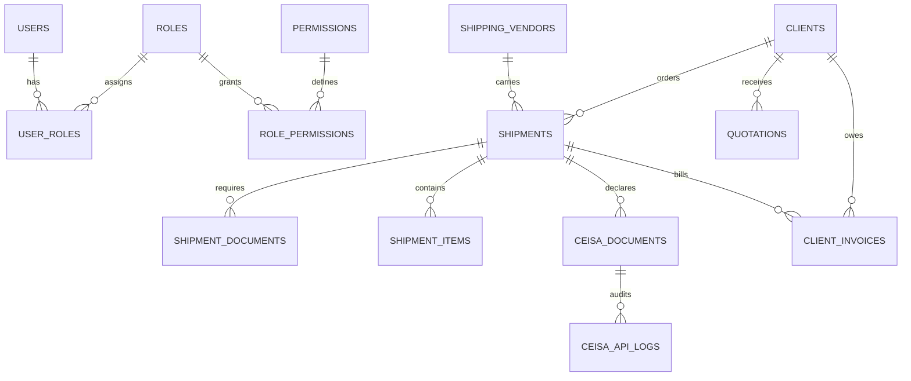

# PRODUCT REQUIREMENT DOCUMENT (PRD) LENGKAP PER FITUR
## SISTEM ERP IMPORT-EXPORT CUSTOM — PATS CEISA
**PT AGUNG TRANS SOLUSINDO**  
*Rujukan Utama: Surat Penawaran No. 001/QT/COOCA/X/2026 & Perjanjian Kerja Sama (PKS) Resmi*  
*Arsitektur: Standalone Enterprise Custom System (Independen / Murni Tanpa Ketergantungan cooca_core)*  
*Standar Data: 100% Primary Key & Foreign Key menggunakan UUID v4 | 100% Penghapusan menggunakan Soft Deletes*  
*Standar Keamanan: 100% Autentikasi & Autorisasi (Gate/Policy/Middleware/Blade) Bawaan Asli Laravel (Native Laravel)*

---

# DAFTAR ISI PRD

1. [Prinsip Arsitektur & Standar Teknis Sistem](#1-prinsip-arsitektur--standar-teknis-sistem)
2. [Alur Operasional End-to-End Berantai (P01 – P19)](#2-alur-operasional-end-to-end-berantai-p01--p19)
3. [Matriks RBAC & Role Akses Permission Bawaan Laravel](#3-matriks-rbac--role-akses-permission-bawaan-laravel)
4. [Spesifikasi Rinci Per Fitur Admin Panel (8 Modul Lengkap)](#4-spesifikasi-rinci-per-fitur-admin-panel-8-modul-lengkap)
   - [Modul 1: Dashboard (Executive & Operational Radar)](#modul-1-dashboard)
   - [Modul 2: Core Bisnis — Tim Document (BC 2.0, BC 3.0, AI HS Code & Billing)](#modul-2-core-bisnis--sub-tim-document)
   - [Modul 2: Core Bisnis — Tim Delivery Order (Shipping Line Vendor & Otomasi Email)](#modul-2-core-bisnis--sub-tim-delivery-order-do)
   - [Modul 2: Core Bisnis — Tim Traffic & Lapangan (Penjaluran, Behandle, Gate Out, POD)](#modul-2-core-bisnis--sub-tim-traffic--lapangan)
   - [Modul 3: HRM (Manajemen Karyawan, Aset, GPS Face Absensi & Payroll)](#modul-3-human-resource-management-hrm)
   - [Modul 4: CRM (Omnichannel WhatsApp, Pipeline, Quotation & Portal Klien)](#modul-4-customer-relationship-management-crm)
   - [Modul 5: Finance (Invoicing P19, Talangan Pabean, AR/AP & Kas Bank)](#modul-5-finance-keuangan-operasional)
   - [Modul 6: Accounting (Bagan Akun COA, Jurnal Otomatis, Laba Rugi per Shipment)](#modul-6-accounting-akuntansi)
   - [Modul 7: AI Agent & MCP (OCR Ekstraksi, Rekomendasi HS Code & Human-in-the-Loop)](#modul-7-ai-agent--mcp-server)
   - [Modul 8: Setting & Konfigurasi (RBAC 12 Peran, Secret Manager, SLA & Master Data)](#modul-8-setting--pengaturan-sistem)
5. [Spesifikasi Template Dokumen Cetak & PDF Resmi](#5-spesifikasi-template-dokumen-cetak--pdf-resmi)
6. [Arsitektur Database Relasional (UUID & Soft Deletes)](#6-arsitektur-database-relasional-uuid--soft-deletes)
7. [Kriteria Penerimaan, SLA, dan Batasan Tanggung Jawab](#7-kriteria-penerimaan-sla-dan-batasan-tanggung-jawab)

---

# 1. PRINSIP ARSITEKTUR & STANDAR TEKNIS SISTEM

### 1.1 Independensi Sistem (Standalone Custom System)
Sistem **PATS_CEISA** dikembangkan khusus untuk **PT Agung Trans Solusindo** sebagai forwarder dan PPJK independen. Sistem ini tidak memiliki ketergantungan paket internal ke `cooca_core` maupun modul eksternal lainnya, berjalan penuh di lingkup repositori `c:\laragon\www\pats_ceisa`.

### 1.2 Standar Identitas UUID (Universally Unique Identifier)
* **Seluruh Primary Key (`id`)** pada setiap tabel basis data wajib bertipe string UUID v4 (36 karakter) menggunakan migrasi `$table->uuid('id')->primary()`.
* **Seluruh Foreign Key (`..._id`)** wajib bertipe `$table->foreignUuid('...')` untuk menjaga integritas relasional non-sekuensial dan keamanan audit.
* Seluruh Eloquent Model mengimplementasikan trait bawaan Laravel `Illuminate\Database\Eloquent\Concerns\HasUuids` dengan properti `$keyType = 'string'` dan `$incrementing = false`.
* Keuntungan: Menghindari *enumeration attack*, mempermudah replikasi multi-server, serta menjamin keunikan identitas data logistik lintas kantor cabang (Jakarta, Surabaya, Semarang).

### 1.3 Standar Penghapusan Data (100% Soft Deletes)
* Seluruh tabel entitas wajib memiliki kolom `deleted_at` melalui migrasi `$table->softDeletes()`.
* Seluruh Eloquent Model wajib menyertakan trait bawaan Laravel `Illuminate\Database\Eloquent\SoftDeletes`.
* Tidak ada penghapusan baris permanen (`HARD DELETE`) pada level operasional bisnis. Segala riwayat pembatalan shipment, invoice salah input, atau pergantian vendor tetap tersimpan dalam basis data dan dapat dipulihkan (*restore*) oleh akun dengan izin Administrator.

### 1.4 Standar Autentikasi & Autorisasi Bawaan Laravel (Pure Native Laravel)
* **Autentikasi:** Menggunakan pustaka resmi `Illuminate\Support\Facades\Auth` berbasis Session/Cookie yang aman, dengan mekanisme regenerasi sesi (`session()->regenerate()`), proteksi CSRF pada setiap form mutasi, dan enkripsi password menggunakan algoritma `bcrypt` bawaan Laravel.
* **Autorisasi:** Menggunakan pustaka resmi `Illuminate\Support\Facades\Gate` dan `Illuminate\Auth\Access\HandlesAuthorization`.
* **Function-Level RBAC:** Pada setiap method di Controller, pengecekan hak akses dieksekusi langsung secara native menggunakan `Gate::authorize('nama.permission')` atau `$this->authorize('ability', $model)`.
* **Blade Directives:** Pengendalian tampilan tombol dan kartu di antarmuka pengguna menggunakan direktif bawaan Laravel `@can('nama.permission')` dan `@cannot('nama.permission')`.
* **Kebijakan Model (Policies):** Setiap entitas kritis (`ShipmentPolicy`, `ClientInvoicePolicy`, `QuotationPolicy`, `CeisaDocumentPolicy`) mengimplementasikan aturan otorisasi berbasis wewenang pengguna dan peran terkait.

### 1.5 Mesin PDF & Spreadsheet Resmi
* **PDF Engine:** Menggunakan `barryvdh/laravel-dompdf` (`Barryvdh\DomPDF\Facade\Pdf`) yang terintegrasi dengan layout cetak presisi A4 (`@page`, `@media print`, border standar kepabeanan DJBC).
* **Spreadsheet Engine:** Menggunakan `phpoffice/phpspreadsheet` untuk impor master data pos tarif BTKI dan ekspor rekapitulasi penagihan / laporan laba rugi.

---

# 2. ALUR OPERASIONAL END-TO-END BERANTAI (P01 – P19)

Operasional logistik impor/ekspor di PT Agung Trans Solusindo berjalan dalam alur berkesinambungan yang menghubungkan 5 divisi utama tanpa jeda informasi:

```mermaid
flowchart TD
    subgraph TIM_DOCUMENT["1. TIM DOCUMENT (BC 2.0 / BC 3.0)"]
        P01["P01: Input Data Klien & Create Project (SHP-YYYYMM-####)"] --> P02["P02: Tracking Kelengkapan Berkas (9 Slot Checklist)"]
        P02 --> P03["P03: Upload Packing List & B/L"]
        P03 --> P04["P04: AI/Rule Deteksi HS Code & Kalkulasi Nilai Pabean"]
        P04 --> P05["P05: Verifikasi Dokumen oleh Supervisor (100% Verified)"]
        P05 --> P06["P06: Draft & Submit CEISA 4.0 (PIB BC 2.0 / PEB BC 3.0)"]
        P06 --> P07["P07: Terbit Kode Billing MPN G3 15-Digit (Handoff ke Tim DO)"]
    end

    subgraph TIM_DO["2. TIM DELIVERY ORDER (DO)"]
        P07 --> P08["P08: Tim DO Menerima Shipment & Pilih Vendor Pelayaran"]
        P08 --> P09["P09: Otomasi Kirim Email Permintaan Invoice ke Vendor Pelayaran"]
        P09 --> P10["P10: Tracking Free Time Demurrage & DO Expired Date"]
        P10 --> P11["P11: Verifikasi Tagihan Lokal & Upload Bukti Bayar"]
        P11 --> P12["P12: Rilis DO Resmi (DO_ISSUED - Handoff ke Tim Traffic)"]
    end

    subgraph TIM_TRAFFIC["3. TIM TRAFFIC & LAPANGAN"]
        P12 --> P13["P13: Konfirmasi Kedatangan Kapal di Pelabuhan (ARRIVED)"]
        P13 --> P14["P14: Monitoring Penjaluran CEISA (Hijau / Kuning / Merah)"]
        P14 --> P15["P15: Penanganan Hold / Behandle SPJM Lapangan Mobile"]
        P15 --> P16["P16: Gate Out Kontainer dari TPS Pelabuhan ke Truk"]
        P16 --> P17["P17: Pengiriman Door Delivery & Konfirmasi POD (DELIVERED)"]
    end

    subgraph FINANCE_ACCOUNTING["4. TIM FINANCE & ACCOUNTING"]
        P17 --> P18["P18: Otomasi Terbit Invoice Klien P19 (Talangan Pabean + Jasa)"]
        P18 --> P19["P19: Pelunasan Billing Pabean NTPN & Jurnal Laba Rugi per Job"]
    end
```



---

# 3. MATRIKS RBAC & ROLE AKSES PERMISSION BAWAAN LARAVEL

Sistem PATS_CEISA membagi wewenang ke dalam 12 peran terdefinisi secara granular. Administrator dan Direktur memiliki hak bypass penuh via `Gate::before()`:

| Kode Peran | Nama Peran | Modul Utama | Tanggung Jawab & Batas Wewenang |
| :--- | :--- | :--- | :--- |
| **`R-ADM`** | System Administrator | Seluruh Modul | Pengaturan sistem, RBAC, konfigurasi API gateway, audit log, backup. |
| **`R-OWN`** | Owner / Direksi | Executive Radar | Pemantauan margin laba kotor, piutang kritis, anomali biaya, KPI divisi. |
| **`R-DOC`** | Staff Tim Document | Tim Dokumen | Pembuatan project shipment, verifikasi dokumen, kalkulasi pabean. |
| **`R-DOC-SPV`** | Supervisor Document | Tim Dokumen | Persetujuan ganda (*double approval*), validasi draft pabean sebelum kirim. |
| **`R-DO`** | Staff Tim DO | Tim DO | Permintaan invoice pelayaran, tracking free time kontainer, rilis DO. |
| **`R-TRF`** | Staff Tim Traffic | Tim Traffic | Monitoring penjaluran pabean, penanganan hold, izin gate out truk. |
| **`R-FLD`** | Petugas Lapangan | Lapangan Pelabuhan | Dokumentasi fisik behandle kontainer, upload foto segel & BAP. |
| **`R-MGR`** | Operations Manager | Seluruh Operasional | Eskalasi SLA terlewati, otorisasi darurat biaya pelayaran dan demurrage. |
| **`R-FIN`** | Staff Finance | Keuangan | Penagihan invoice P19 klien, pelunasan billing MPN, AP/AR aging. |
| **`R-HR`** | Staff HRM | Kepegawaian | Pengelolaan master karyawan, absensi GPS, cuti, mutasi aset, payroll. |
| **`R-CS`** | Customer Service | CRM & Komunikasi | Penanganan inbox omnichannel WhatsApp, update status kargo klien. |
| **`R-AM`** | Account Manager | Sales & CRM | Pembuatan surat penawaran harga (Quotation), negosiasi tarif, deal tracking. |

### Matriks 20 Kode Izin (Permissions) & Proteksi Function Controller
Setiap permission didaftarkan pada tabel `permissions` dan diproteksi di controller terkait:

```php
// Contoh Proteksi Native Laravel di Level Function Controller:
public function store(Request $request) {
    Gate::authorize('document.create');
    // Logika penyimpanan data berlanjut jika diizinkan...
}
```

1. `dashboard.view` $\rightarrow$ Akses visualisasi KPI dan radar shipment aktif.
2. `document.view` $\rightarrow$ Membuka data proyek shipment dan dokumen pelengkap.
3. `document.create` $\rightarrow$ Membuat proyek shipment baru dan mengunggah berkas.
4. `document.verify` $\rightarrow$ Memberikan status verifikasi pada berkas checklist.
5. `document.submit` $\rightarrow$ Mengirim dokumen BC 2.0 / BC 3.0 ke CEISA 4.0 via H2H.
6. `do.view` $\rightarrow$ Memantau antrian penebusan DO dan daftar pelayaran.
7. `do.process` $\rightarrow$ Mengirim email otomatis permohonan invoice ke pelayaran.
8. `do.release` $\rightarrow$ Mengesahkan penerbitan DO asli dan menginput batas expired.
9. `traffic.view` $\rightarrow$ Membuka radar penjaluran pabean dan pergerakan armada.
10. `traffic.process` $\rightarrow$ Mengupdate jalur pabean, behandle, dan konfirmasi POD.
11. `traffic.gateout` $\rightarrow$ Mengizinkan kontainer keluar gerbang pelabuhan (Gate Out).
12. `hrm.view` $\rightarrow$ Melihat direktori pegawai dan kehadiran.
13. `hrm.manage` $\rightarrow$ Mengelola kontrak PKWT/PKWTT, cuti, mutasi aset, dan gaji.
14. `crm.view` $\rightarrow$ Membuka obrolan omnichannel dan direktori kontak.
15. `crm.deal` $\rightarrow$ Menerbitkan surat penawaran harga (Quotation) dan mengelola prospek.
16. `finance.view` $\rightarrow$ Memantau invoice klien, rekapitulasi biaya, dan kas/bank.
17. `finance.invoice` $\rightarrow$ Menerbitkan dan mengedit draf Invoice Penagihan Klien P19.
18. `finance.pay` $\rightarrow$ Mencatat pelunasan invoice klien dan pembayaran billing MPN.
19. `accounting.view` $\rightarrow$ Mengakses laporan keuangan (Neraca, Laba Rugi per Job, COA).
20. `setting.manage` $\rightarrow$ Mengelola akun pengguna, RBAC, dan kredensial API.

---

# 4. SPESIFIKASI RINCI PER FITUR ADMIN PANEL (8 MODUL LENGKAP)

---

## MODUL 1: DASHBOARD

### 1.1 Tujuan
Pusat kendali visual real-time terintegrasi yang menyajikan status operasional harian, peringatan dini denda pelabuhan, dan ringkasan keuangan dalam waktu respon $\le 1.5$ detik.

### 1.2 Daftar Fitur Rinci
* **DSH-01: Bento Metrics Command Center**
  * *Deskripsi:* Kartu metrik modular yang menampilkan 4 indikator utama: Total Proyek Berjalan, Dokumen Pabean Aktif, Billing MPN Menunggu Pembayaran, dan SPPB/NPE Terbit Hari Ini.
  * *Aturan Bisnis:* Menghitung agregat langsung dari database secara real-time. Klik pada tiap kartu langsung memfilter tabel shipment terkait.
* **DSH-02: Early Warning Radar Free Time & Demurrage**
  * *Deskripsi:* Perhitungan otomatis sisa hari bebas penumpukan (*free storage* TPS) dan masa bebas kontainer (*free time detention* pelayaran).
  * *Indikator Visual:*
    * Hijau: Sisa hari $> 3$ hari.
    * Kuning: Sisa hari $2 - 3$ hari.
    * Merah (Kritis): Sisa hari $\le 1$ hari atau telah melewati batas (muncul denda berjalan per hari).
* **DSH-03: Live Customs Clearance Status Radar**
  * *Deskripsi:* Pemantauan visual kontainer berdasarkan jalur respon CEISA 4.0 (Jalur Hijau, Jalur Kuning/SPJK, Jalur Merah/SPJM, Status Hold/Notul).
  * *Aksi Cepat:* Klik nomor BL membuka detail penanganan pabean dan kontak PIC lapangan bertugas.
* **DSH-04: Executive Financial Snapshot (Khusus `R-OWN` & `R-FIN`)**
  * *Deskripsi:* Menampilkan total piutang klien jatuh tempo (*Account Receivable Overdue*), total hutang pelayaran (*Account Payable*), dan estimasi gross margin bulan berjalan.

---

## MODUL 2: CORE BISNIS — SUB-TIM DOCUMENT

### 2.1 Tujuan
Menangani tahapan prapabean dari input klien, pengumpulan 9 berkas wajib, ekstraksi otomatis packing list, penentuan pos tarif HS Code, hingga pengiriman dokumen pabean BC 2.0 (PIB) dan BC 3.0 (PEB) ke CEISA 4.0 DJBC sampai terbit Kode Billing MPN G3 15-digit.

### 2.2 Alur Kerja Lengkap Sub-Tim Document
1. **Input Data Klien & Pembuatan Proyek (P01):** Tim Dokumen memilih klien dari Master Klien atau menginput klien baru. Sistem memvalidasi masa berlaku Surat Kuasa PPJK dan legalitas NIB/NPWP.
2. **Inisialisasi 9 Slot Checklist Dokumen Wajib:** Begitu proyek tersimpan, sistem secara otomatis membuat 9 baris checklist pada tabel `shipment_documents`:
   1. `INVOICE` (Commercial Invoice dari Supplier Luar Negeri)
   2. `PACKING_LIST` (Packing List Rincian Barang)
   3. `BILL_OF_LADING` (Master/House Bill of Lading atau AWB)
   4. `CERTIFICATE_OF_ORIGIN` (COO Form E / Form D / Form AK fasilitas FTA)
   5. `IMPORT_PERMIT` (Persetujuan Impor / Lartas Kemendag jika wajib)
   6. `SURAT_KUASA` (Surat Kuasa PPJK bermaterai)
   7. `DOKUMEN_PELENGKAP` (Bukti Bayar Telegraphic Transfer / LC)
   8. `DRAFT_PIB_PEB` (Draft Dokumen Pabean Sistem)
   9. `BILLING_CEISA` (Bukti Kode Billing MPN G3 DJBC)
3. **Upload Packing List & Deteksi HS Code Otomatis:**
   * Saat staf mengunggah berkas Packing List (PDF/Excel), mesin ekstraksi membaca deskripsi komoditas, jumlah koli, berat kotor (*gross weight*), dan nilai invoice.
   * Mesin pencocokan mencocokkan teks barang terhadap database Buku Tarif Kepabeanan Indonesia (BTKI 2022/2027) dan menyajikan usulan pos tarif 8-digit.
   * *Prinsip Human-in-the-Loop:* Staf pabean (`R-DOC`) wajib memeriksa dan menekan tombol konfirmasi pos tarif sebelum disimpan permanen.
4. **Three-Way Matching Validation:** Sistem melakukan verifikasi matematis antara Invoice, Packing List, dan B/L. Jika terdapat selisih total koli atau perbedaan nama importir, sistem memberi penanda peringatan merah.
5. **Supervisor Double-Review (Approval P06):** Supervisor Dokumen (`R-DOC-SPV`) memeriksa kesiapan berkas. Status berubah menjadi `DOC_VERIFIED`.
6. **Submit Host-to-Host CEISA 4.0:**
   * Men-generate Nomor Pengajuan resmi 26 digit berformat: `{KodeKantor}-{IdPPJK}-{YYYYMMDD}-{NomorUrut}`.
   * Mengirim payload JSON standar DJBC ke endpoint CEISA 4.0 Gateway via OAuth 2.0 Token.
   * Menarik respon balik dari Bea Cukai: Nomor Pendaftaran dan **Kode Billing MPN G3 15-digit**.
   * Status shipment diperbarui ke `DOC_COMPLETED` / `BILLING_ISSUED`. Tahap Tim Dokumen selesai 100%, sistem otomatis menugaskan shipment ke antrian Tim DO.

---

## MODUL 2: CORE BISNIS — SUB-TIM DELIVERY ORDER (DO)

### 2.1 Tujuan
Mengelola komunikasi dengan pihak pelayaran/shipping line, memastikan seluruh tagihan biaya lokal (*ocean freight, terminal handling charge, administration fee*) terverifikasi, dan menjamin dokumen Delivery Order (DO) telah dirilis sebelum kapal sandar di pelabuhan.

### 2.2 Alur Kerja Lengkap Sub-Tim DO
1. **Penerimaan Handoff dari Tim Dokumen:** Shipment yang telah memiliki nomor billing pabean otomatis muncul di antrian kerja Tim DO.
2. **Master Shipping Line Vendors:** Sistem menyediakan database lengkap vendor pelayaran internasional dan keagenan lokal:
   * Maersk Line Indonesia (`id.import@maersk.com`)
   * Ocean Network Express / ONE (`id.expdo@one-line.com`)
   * Evergreen Shipping Agency (`do-jakarta@evergreen-shipping.co.id`)
   * COSCO Shipping Lines (`id.importcs@coscon.com`)
   * Samudera Indonesia (`customercare@samudera.id`)
3. **Otomasi Pengiriman Email Permintaan Invoice:**
   * Tim DO mengklik tombol **"Kirim Email Permintaan Invoice ke Pelayaran"**.
   * Sistem secara otomatis menyusun surat resmi digital berisikan nomor B/L, nama kapal, voyage, nomor kontainer, dan melampirkan copy B/L.
   * Email terkirim langsung ke kontak resmi loket rilis pelayaran terkait via SMTP perusahaan.
   * Status shipment diperbarui menjadi `DO_REQUESTED`.
4. **Tracking Free Time & Masa Kedaluwarsa DO (DO Expired Date):**
   * Tim DO menginput tanggal batas *free time detention/demurrage* (standar 7–14 hari).
   * Sistem menghitung mundur sisa hari secara otomatis setiap hari pukul 00:00 WIB.
5. **Verifikasi Pembayaran Biaya Pelayaran & Release DO:**
   * Staf mengunggah bukti bayar invoice pelayaran dan menginput nomor DO resmi serta tanggal kedaluwarsa DO (*valid until*).
   * Menekan tombol **"Release Delivery Order"**.
   * Status shipment berubah menjadi `DO_ISSUED` (`do_is_released = true`). Sistem menerbitkan berkas PDF Surat Permohonan Rilis DO dan mengalihkan tugas ke antrian Tim Traffic.

---

## MODUL 2: CORE BISNIS — SUB-TIM TRAFFIC & LAPANGAN

### 3.1 Tujuan
Mengawasi pergerakan fisik kargo di terminal petikemas pelabuhan, menangani respon penjaluran pabean, menyelesaikan pemeriksaan fisik barang (behandle) bila terkena jalur merah, mengeksekusi gate out pelabuhan, dan mengantarkan barang sampai di gudang klien dengan bukti *Proof of Delivery* (POD).

### 3.2 Alur Kerja Lengkap Sub-Tim Traffic
1. **Konfirmasi Kedatangan Kapal (ARRIVED):** Staf memvalidasi kedatangan fisik kapal sandar di dermaga Terminal Petikemas (misal: JICT, Koja, NPCT1 di Tanjung Priok).
2. **Respon Penjaluran Kepabeanan (Customs Channeling):**
   * **Jalur Hijau:** Dokumen PIB disetujui langsung tanpa periksa fisik/dokumen; sistem menunggu penerbitan Surat Persetujuan Pengeluaran Barang (SPPB).
   * **Jalur Kuning (SPJK):** Pejabat pabean meminta penyerahan fisik berkas pelengkap; sistem membuat tugas pengiriman berkas ke loket Bea Cukai.
   * **Jalur Merah (SPJM):** Pejabat pabean menetapkan Surat Pemberitahuan Jalur Merah (SPJM); sistem otomatis menjadwalkan pemeriksaan fisik (behandle).
   * **Status Hold / Sengketa Notul:** Manajemen kendala pabean (Nota Pembetulan / SPTNP, Nota Pemberitahuan Dokumen / NPD). Sistem mencatat alasan hold, nilai jaminan notul, dan tenggat waktu sanggahan.
3. **Pemeriksaan Lapangan Behandle (Mobile App / Web Mobile):**
   * Petugas lapangan (`R-FLD`) hadir di depo behandle pelabuhan.
   * Mengunggah 4 foto wajib: Foto nomor kontainer tampak luar, foto segel Bea Cukai utuh sebelum dibuka, foto fisik isi barang saat pencacahan, dan foto Berita Acara Pemeriksaan (BAP) bertanda tangan Pejabat Pemeriksa Bea Cukai.
4. **Penerbitan SPPB & Eksekusi Gate Out Pelabuhan:**
   * Setelah SPPB terbit dan DO berstatus rilis, tombol **"Eksekusi Gate Out"** menjadi aktif.
   * Tim Traffic menginput nomor polisi truk trailer, nama supir, nomor surat jalan ekspedisi, dan mencatat waktu truk keluar dari gerbang TPS (*Gate Out Timestamp*).
   * Status shipment berubah menjadi `GATE_OUT`.
5. **Pengiriman & Bukti Serah Terima (POD - Proof of Delivery):**
   * Truk mengantarkan kargo ke lokasi pabrik/gudang klien.
   * Klien menandatangani Surat Jalan basah dan memeriksa kondisi kargo.
   * Tim Traffic menginput nama penerima, mengunggah foto surat jalan bertanda tangan basah + stempel klien, dan mengubah status menjadi `DELIVERED`.
   * **Pemicu Otomatis:** Begitu status berubah menjadi `DELIVERED`, sistem secara otomatis membuat draft **Invoice Penagihan Klien (P19)** pada modul Finance.

---

## MODUL 3: HUMAN RESOURCE MANAGEMENT (HRM)

### 3.1 Tujuan
Mengelola siklus hidup data karyawan logistik, pemetaan peran sistem, kehadiran presisi berbasis radius lokasi dan verifikasi wajah, pengalihan penugasan otomatis saat cuti, serta pemrosesan payroll dasar.

### 3.2 Daftar Fitur Rinci
* **HRM-01: Master Pegawai & Berkas Kepegawaian**
  * Pencatatan biodata karyawan, nomor KTP, NPWP, jabatan, divisi operasional, nomor rekening penggajian, dan pemetaan ke akun pengguna sistem.
  * Penyimpanan berkas sertifikat resmi (Sertifikat Ahli Kepabeanan PPJK DJBC, sertifikat Dangerous Goods).
* **HRM-02: Manajemen Kontrak Kerja (PKWT / PKWTT)**
  * Pencatatan masa berlaku kontrak kerja. Notifikasi otomatis ke HRD 30 hari sebelum masa kontrak habis.
* **HRM-03: Manajemen Aset & Inventaris Lapangan**
  * Pendataan aset yang dipinjamkan ke staf (laptop operasional, printer label barcode lapangan, handphone dinas lapangan).
* **HRM-04: Absensi Geolocation & Face Recognition**
  * Check-in / Check-out pegawai berbasis verifikasi foto wajah dan validasi koordinat GPS radius kantor.
  * Khusus petugas lapangan (`R-FLD`), sistem mengizinkan check-in dinas luar di lokasi koordinat Pelabuhan Tanjung Priok / Marunda.
* **HRM-05: Manajemen Cuti & Auto-Reassign PIC Shipment**
  * Pengajuan cuti tahunan, sakit, dan izin.
  * **Aturan Kritis Operasional:** Saat pengajuan cuti disetujui oleh atasan, sistem secara otomatis mengalihkan seluruh penugasan proyek shipment aktif milik staf tersebut kepada PIC Pengganti (*Backup Officer*) agar operasional tidak mengalami keterlambatan SLA.
* **HRM-06: Manajemen Lembur & Kasbon Karyawan**
  * Pencatatan Surat Perintah Lembur (SPL) penanganan kapal akhir pekan / malam hari.
  * Pengajuan kasbon staf yang otomatis dipotong pada penerbitan slip gaji bulanan.
* **HRM-07: Payroll Dasar & Slip Gaji PDF**
  * Perhitungan gaji bulanan: Gaji Pokok + Tunjangan Jabatan + Uang Lembur - Potongan BPJS/Kasbon/Absensi.
  * Menghasilkan Slip Gaji PDF resmi dan membuat draf jurnal beban gaji ke modul Accounting.

---

## MODUL 4: CUSTOMER RELATIONSHIP MANAGEMENT (CRM)

### 4.1 Tujuan
Mengintegrasikan saluran komunikasi klien ke dalam satu kotak masuk terpadu (*omnichannel inbox*), mengelola pipa penjualan prospek forwarder, menerbitkan surat penawaran harga resmi (Quotation), dan menyediakan portal pelacakan mandiri bagi klien tanpa password.

### 4.2 Daftar Fitur Rinci
* **CRM-01: Omnichannel Inbox WhatsApp Resmi (Meta WABA)**
  * Menghubungkan nomor WhatsApp Business API resmi PT Agung Trans Solusindo ke dalam satu inbox terpadu yang dapat diakses oleh tim CS dan Account Manager secara bergantian.
* **CRM-02: Koneksi Kontak Obrolan ke Data Shipment**
  * Sidebar obrolan langsung menampilkan profil perusahaan klien, riwayat order, nomor shipment aktif, posisi kapal, dan status kendala pabean tanpa harus berpindah modul.
* **CRM-03: Sales Pipeline & Deal Tracking**
  * Tahapan prospek klien baru: *Lead $\rightarrow$ Kualifikasi Komoditas $\rightarrow$ Penawaran Tarif (Quotation) $\rightarrow$ Negosiasi $\rightarrow$ Deal / PKS Ditandatangani*.
* **CRM-04: Generator Surat Penawaran Harga (Quotation Forwarder & PPJK)**
  * Penyusunan penawaran harga pengiriman impor/ekspor (komponen: *Ocean Freight, THC, DO Fee, Handling PPJK, Trucking Trailer*).
  * Menghasilkan dokumen resmi PDF Quotation ber-kop surat PT Agung Trans Solusindo dengan validitas penawaran 30 hari.
* **CRM-05: Portal Klien Mandiri Tanpa Password via Token Link**
  * Klien dapat mengecek perkembangan kargo mereka melalui link unik ber-token aman dengan verifikasi kode OTP ke email/WhatsApp resmi klien.
  * Klien dapat melihat lini masa perjalanan kontainer, mengunduh salinan berkas SPPB/NPE, dan mengunggah berkas perizinan susulan secara mandiri.

---

## MODUL 5: FINANCE (KEUANGAN OPERASIONAL)

### 5.1 Tujuan
Mengelola perputaran dana talangan kepabeanan (*reimbursable funds*), penagihan invoice resmi P19 ke klien, monitoring umur piutang (AR) dan hutang operasional pelayaran (AP), serta rekonsiliasi kas bank multi-rekening.

### 5.2 Daftar Fitur Rinci
* **FIN-01: Invoice Penagihan Klien (P19 Client Invoicing)**
  * Menerbitkan berkas tagihan resmi ke klien dengan pemisahan tegas antara:
    1. **Komponen Talangan Pabean (Reimbursable - Non PPN):** Bea Masuk, PPN Impor, PPh 22 Impor sesuai nominal Bukti Penerimaan Negara (BPN SSPCP).
    2. **Komponen Biaya Pihak Ketiga (Shipping & Port Charges):** Ocean Freight, THC, Lift On/Off, DO Administration Fee, Penumpukan TPS.
    3. **Komponen Jasa Perusahaan (Forwarding Fee):** Customs Clearance Fee, EDI Pabean, Trucking Inland Transport (Dikenakan PPN Jasa 1.1% dan bukti potong PPh 23).
* **FIN-02: Pengawasan Piutang Klien (Account Receivable / AR Aging)**
  * Menampilkan laporan umur piutang per klien: *Lancar (0–14 hari), Menengah (15–30 hari), Kritis (31–60 hari), Macet (>60 hari)*.
  * Peringatan otomatis ke Account Manager bila klien melebihi batas plafon kredit (*credit limit*) sebelum proyek baru disetujui.
* **FIN-03: Pengawasan Hutang Vendor (Account Payable / AP Aging)**
  * Penjadwalan pembayaran tagihan pelayaran (*freight/THC*), depo kontainer, dan vendor truk mitra untuk mencegah pembekuan akun rilis DO.
* **FIN-04: Manajemen Kas & Bank Multi-Rekening**
  * Pengelolaan buku kas terpisah: Rekening Khusus Talangan Pabean (Bank Mandiri), Rekening Operasional (BCA), dan Kas Kecil Lapangan (*Petty Cash Pelabuhan*).
* **FIN-05: Pelunasan Billing Pabean MPN G3**
  * Pencatatan Nomor Transaksi Penerimaan Negara (NTPN), Nomor Transaksi Bank (NTB), dan pengarsipan Bukti Penerimaan Negara (BPN) sebagai bukti sah pelunasan pungutan impor.

---

## MODUL 6: ACCOUNTING (AKUNTANSI)

### 6.1 Tujuan
Menyediakan pembukuan standar akuntansi keuangan ganda (*double-entry bookkeeping*) yang mencatat jurnal transaksi operasional logistik secara otomatis tanpa perlu input manual berulang.

### 6.2 Daftar Fitur Rinci
* **ACC-01: Bagan Akun Standar Logistik (Chart of Accounts / COA)**
  * Struktur akun baku: Kas & Bank (1110), Piutang Usaha Klien (1120), Talangan Pabean Dibayar Dimuka (1130), Hutang Pelayaran (2110), Hutang Pajak PPN Pabean (2130), Pendapatan Jasa PPJK (4110), Pendapatan Trucking (4120), Beban Operasional Pelabuhan (5110).
* **ACC-02: Jurnal Otomatis (Auto-Journal Engine)**
  * Terpicu otomatis pada momen transaksi kunci:
    * *Saat Billing Pabean Ditalangi:* (Debit) Piutang Talangan Pabean Klien | (Kredit) Kas Bank Mandiri.
    * *Saat Invoice Klien Diterbitkan:* (Debit) Piutang Usaha | (Kredit) Pendapatan Jasa PPJK, Pendapatan Trucking, Hutang PPN Keluaran, Piutang Talangan Pabean.
    * *Saat Invoice Klien Dilunasi:* (Debit) Kas Bank BCA | (Kredit) Piutang Usaha.
* **ACC-03: Laporan Laba Rugi per Nomor Shipment (Gross Profit Margin per Job)**
  * Analisis profitabilitas presisi per kontainer/shipment: *Pendapatan Penagihan Klien dikurangi Beban Riil (Biaya Pelayaran + Biaya Depo + Trucking + Biaya Operasional)*.
* **ACC-04: Laporan Keuangan Standar (Neraca, Laba Rugi Komparatif, Arus Kas)**
  * Laporan Neraca Saldo, Laporan Laba Rugi bulanan/tahunan, dan Laporan Arus Kas metode langsung yang dapat diekspor ke format Excel dan PDF.

---

## MODUL 7: AI AGENT & MCP SERVER

### 7.1 Tujuan
Menyediakan asisten kecerdasan buatan berbasis standar resmi Model Context Protocol (MCP) untuk mempercepat ekstraksi data dokumen, merekomendasikan pos tarif kepabeanan, mendeteksi anomali biaya, dan memberikan briefing harian kepada jajaran direksi.

### 7.2 Daftar Fitur Rinci
* **AI-01: Ekstraksi Dokumen Multimodal (OCR/LLM)**
  * Membaca berkas Packing List dan Invoice berbahasa asing (Inggris, Mandarin, Jepang) dalam format PDF/scan, lalu mengekstrak uraian barang, kuantiti, berat kotor, dan nilai barang menjadi data baris terstruktur dalam waktu $\le 10$ detik.
* **AI-02: AI Pos Tarif & HS Code Recommendation Engine**
  * Memberikan rekomendasi pos tarif 8-digit BTKI berdasarkan uraian spesifikasi bahan, fungsi teknis, dan negara asal.
  * Menampilkan dasar hukum, aturan lartas instansi terkait, dan persentase keyakinan model (*confidence score*).
* **AI-03: Prinsip Wajib Human-in-the-Loop (Sesuai Pasal 13 PKS)**
  * Hasil ekstraksi dan rekomendasi AI **hanya berstatus usulan/draft**. Seluruh penetapan kode pos tarif, pengiriman dokumen ke Bea Cukai, serta persetujuan pembayaran keuangan mutlak wajib dikonfirmasi oleh staf manusia berwenang.
* **AI-04: Server MCP Berbasis Peran (Model Context Protocol)**
  * Menyediakan tools aman yang hanya dapat memanggil fungsi internal sistem yang telah melewati validasi izin peran: `get_shipment_status`, `check_free_time`, `calculate_customs_duty`, `detect_unpaid_invoices`.
* **AI-05: Laporan Proaktif Harian (Morning Operational Briefing)**
  * AI Agent otomatis menyusun rangkuman singkat setiap hari kerja pukul 07:30 WIB ke pimpinan: daftar kontainer yang mendekati denda *free time*, shipment berjalur merah, dan tagihan invoice yang jatuh tempo hari ini.

---

## MODUL 8: SETTING & PENGATURAN SISTEM

### 8.1 Tujuan
Menjadi pusat kendali administratif untuk mengonfigurasi parameter sistem, mengelola pengguna dan izin peran (RBAC), mengamankan kredensial pihak ketiga, dan mencatat jejak audit tanpa memerlukan perubahan kode program (*zero-code configuration*).

### 8.2 Daftar Fitur Rinci
* **SET-01: Manajemen Pengguna & Hak Akses RBAC 12 Peran**
  * Tambah/edit akun staf, penugasan satu atau beberapa peran, penggantian password, aktivasi/penonaktifan akun, dan pengaturan hak akses permission secara matriks centang.
* **SET-02: Secret Manager Kredensial CEISA 4.0 & API Pihak Ketiga**
  * Penyimpanan aman terenkripsi (AES-256) untuk kredensial integrasi: Username/Password Portal CEISA 4.0, Client ID, Client Secret, API Key INSW, Meta WABA Token, dan Mail SMTP.
* **SET-03: Master Data Logistik & Kepabeanan**
  * Katalog Master Kantor Pelayanan Bea Cukai (KPU Tanjung Priok, KPU Soekarno Hatta, KPPBC Tanjung Perak, dll).
  * Katalog Master Pelabuhan Dunia (UN/LOCODE), Negara ISO, Valuta Asing, dan Kurs Pajak Mingguan KMK (NDPBM).
* **SET-04: Parameter Ambang Batas SLA & Jam Kerja Operasional**
  * Konfigurasi batas waktu penanganan per tahapan: SLA pembuatan draf PIB ($\le 4$ jam), SLA pembayaran billing ($\le 24$ jam), SLA konfirmasi rilis DO ($\le 12$ jam).
  * Perhitungan SLA secara cerdas mengecualikan hari libur nasional dan waktu di luar jam kerja resmi.
* **SET-05: Jejak Audit Sistem (System Audit Trail)**
  * Rekaman log aktivitas mutlak (*append-only*): mencatat ID pengguna, alamat IP, user-agent, jenis aksi, nilai data lama (*old values*), nilai data baru (*new values*), dan cap waktu mikrodetik. Data log audit tidak dapat dihapus atau diubah oleh siapapun.
* **SET-06: Manajemen Pencadangan & Pemulihan (Backup & Restore)**
  * Penjadwalan pencadangan otomatis harian untuk basis data dan berkas dokumen arsip ke lokasi penyimpanan aman terpisah.

---

# 5. SPESIFIKASI TEMPLATE DOKUMEN CETAK & PDF RESMI

Sistem menyediakan 6 template cetak siap pakai berstandar industri dengan layout A4 presisi:

### 5.1 PIB BC 2.0 (Pemberitahuan Impor Barang Resmi DJBC)
* **File View:** `resources/views/pdf/pib.blade.php`
* **Route:** `GET /print/shipments/{id}/pib`
* **Struktur Template:**
  * Header Kementerian Keuangan RI — Direktorat Jenderal Bea dan Cukai.
  * Nomor Pengajuan 26-digit ber-barcode visual dan Kantor Pabean Bongkar.
  * Kolom A: Identitas Importir (Nama, NPWP 16 digit, NIB, Alamat) dan PPJK (PT Agung Trans Solusindo, No Pokok PPJK).
  * Kolom B: Sarana Pengangkut (Nama Kapal, Voyage, Bendera), Pelabuhan Muat/Bongkar/TPS, Dokumen Pelengkap (No B/L, Invoice, PL, COO).
  * Kolom C: Data Nilai Transaksi (Valuta USD, Nilai CIF, NDPBM Kurs KMK, Nilai Pabean IDR).
  * Kolom D: Rincian Barang Pabean (Pos Tarif HS 8-digit, Uraian Barang, Negara Asal, Jumlah Koli, Berat Bersih kg, Nilai Pabean).
  * Kolom E: Perhitungan Pungutan Pabean (Bea Masuk 5%, PPN 11%, PPh Pasal 22 2.5%, Total Pungutan Billing MPN G3).
  * Kolom Pengesahan: Kode Billing SIMPONI, batas waktu pembayaran, tanda tangan Ahli Kepabeanan PPJK.

### 5.2 PEB BC 3.0 (Pemberitahuan Ekspor Barang Resmi DJBC)
* **File View:** `resources/views/pdf/peb.blade.php`
* **Route:** `GET /print/shipments/{id}/peb`
* **Struktur Template:**
  * Header Direktorat Jenderal Bea dan Cukai — Pemberitahuan Ekspor Barang.
  * Nomor Pengajuan 26-digit, Kantor Pabean Pemuatan, Nomor Pendaftaran NPE (Nota Pelayanan Ekspor).
  * Identitas Eksportir, PPJK Kuasa, dan Pembeli Asing (Buyer Luar Negeri).
  * Pelabuhan Muat, Pelabuhan Bongkar/Tujuan, Negara Tujuan Ekspor, Sarana Pengangkut.
  * Nilai Devisa Hasil Ekspor (FOB USD, Kurs KMK, Nilai FOB IDR).
  * Rincian Barang Ekspor, Pos Tarif BTKI, Jumlah Netto kg, Pungutan Ekspor (Bea Keluar & Pungutan Sawit).
  * Status Respon CEISA 4.0: NPE Diberikan Ijin Muat, tanda tangan spesialis kepabeanan ekspor.

### 5.3 Invoice Penagihan Klien P19
* **File View:** `resources/views/pdf/invoice.blade.php`
* **Route:** `GET /print/invoices/{id}`
* **Struktur Template:**
  * Kop Resmi PT Agung Trans Solusindo (Alamat Tanjung Priok Jakarta Utara, Telepon, NPWP Perusahaan).
  * Identitas Invoice: Nomor Invoice (`INV-YYYYMM-####`), Tanggal Terbit, Tanggal Jatuh Tempo, Tagihan Kepada (*Bill To*).
  * Rujukan Pengiriman: Job Order (`SHP-YYYYMM-####`), Nomor B/L, Nama Kapal/Voyage, Ukuran Kontainer.
  * Tabel Rincian Biaya Transparan:
    1. *Pungutan Resmi Pabean (Reimbursable):* Bea Masuk, PPN Impor, PPh 22 Impor (Sesuai Bukti BPN SSPCP - Bebas PPN Jasa).
    2. *Biaya Pelayaran & Terminal:* Terminal Handling Charges (THC), Lift On/Off, DO Administration Fee.
    3. *Jasa Pengurusan & Transportasi:* Customs Clearance Fee, EDI Fee, Trucking Inland Transport Trailer.
  * Rekapitulasi: Total Talangan Pabean, Total Biaya Pelayaran, Total Jasa PPJK, PPN Jasa 1.1%, **Total Tagihan Akhir**.
  * Petunjuk Pembayaran: Nomor Rekening Resmi Bank Mandiri & Bank BCA atas nama PT Agung Trans Solusindo.
  * Tanda tangan Finance Manager dan stempel perusahaan.

### 5.4 Surat Penawaran Harga (Quotation Forwarder & PPJK)
* **File View:** `resources/views/pdf/quotation.blade.php`
* **Route:** `GET /print/quotations/{id}`
* **Struktur Template:**
  * Kop Surat PT Agung Trans Solusindo — Integrated Freight Logistics & Customs Brokerage.
  * Nomor Quotation (`QUO-YYYYMM-####`), Tanggal Terbit, Masa Berlaku (*Valid Until* 30 Hari).
  * Ditujukan kepada pimpinan / bagian impor perusahaan klien prospek.
  * Spesifikasi Rute & Layanan: Pelabuhan Asal $\rightarrow$ Pelabuhan Tujuan, Tipe Layanan (FCL / LCL), Ukuran Kontainer.
  * Tabel Penawaran Tarif: Ocean Freight per TEU, THC Pelabuhan, DO Fee, Handling Fee PPJK, Trucking Door Delivery.
  * Syarat & Ketentuan Baku (*Terms & Conditions*): Ketentuan denda demurrage/storage, dokumen wajib, termin pembayaran 14 hari.
  * Lembar pengesahan ganda: Tanda tangan Account Manager PT ATS dan kolom konfirmasi persetujuan klien.

### 5.5 Surat Permohonan Rilis Delivery Order (DO Request Letter)
* **File View:** `resources/views/pdf/do_request.blade.php`
* **Route:** `GET /print/shipments/{id}/do-request`
* **Struktur Template:**
  * Kop Surat Resmi PT Agung Trans Solusindo.
  * Nomor Surat Permohonan (`ATS/DO-REQ/YYYYMM/########`), Perihal: Permohonan Rilis DO Online.
  * Ditujukan kepada Customer Service / Bagian Rilis DO Maskapai Pelayaran (Maersk, ONE, Evergreen, Cosco, Samudera).
  * Data Rincian Kargo: Nomor B/L, Nama Kapal/Voyage, Nomor Petikemas, Nama Importir (*Consignee*), Tanggal ETA.
  * Pernyataan pemenuhan kewajiban biaya lokal (Ocean Freight, THC, Admin DO) dengan melampirkan copy B/L dan bukti bayar.
  * Tanda tangan resmi Head of Shipping Line & DO Clearance.

### 5.6 Cetak Kode Billing MPN G3 / SSPCP DJBC
* **File View:** `resources/views/pdf/billing_mpn.blade.php`
* **Route:** `GET /print/shipments/{id}/billing`
* **Struktur Template:**
  * Header Kementerian Keuangan RI — Surat Setoran Pabean, Cukai, dan Pajak (SSPCP).
  * **Kotak Kode Billing Utama (15 Digit MPN G3)** dengan font tebal dan batas masa aktif kedaluwarsa billing.
  * Identitas Wajib Bayar (Importir), Kantor Penerbit Bea Cukai, Nomor Aju 26 digit.
  * Rincian Setoran Mata Anggaran: Akun 412111 (Bea Masuk), Akun 411123 (PPN Impor), Akun 411124 (PPh 22 Impor).
  * Total Penerimaan Negara Disetor dan Terbilang Rupiah.
  * Status Pembayaran SIMPONI (Nomor Transaksi Bank NTB & Nomor Transaksi Penerimaan Negara NTPN).

---

# 6. ARSITEKTUR DATABASE RELASIONAL (UUID & SOFT DELETES)

### 6.1 Diagram Entitas Relasional (ERD)



### 6.2 Spesifikasi Skema Tabel Basis Data (Seluruhnya Ber-UUID & SoftDeletes)

1. **`users`**
   * `id`: UUID (Primary Key)
   * `name`: VARCHAR(255)
   * `email`: VARCHAR(255) (Unique)
   * `password`: VARCHAR(255) (Hashed)
   * `phone`, `job_title`, `department`: VARCHAR
   * `is_active`: BOOLEAN (Default: true)
   * `created_at`, `updated_at`: TIMESTAMP
   * `deleted_at`: TIMESTAMP (SoftDeletes)

2. **`roles` & `permissions`**
   * `id`: UUID (Primary Key)
   * `code`: VARCHAR(50) (Unique Index) — cth: `R-DOC`, `document.create`
   * `name`, `module`, `description`: VARCHAR/TEXT
   * `deleted_at`: TIMESTAMP (SoftDeletes)

3. **`clients`**
   * `id`: UUID (Primary Key)
   * `client_code`: VARCHAR(30) (Unique Index)
   * `name`: VARCHAR(255)
   * `npwp`: VARCHAR(30)
   * `nib`: VARCHAR(30)
   * `address`: TEXT
   * `pic_name`, `pic_phone`, `email`: VARCHAR
   * `credit_limit_days`: INTEGER (Default: 14)
   * `deleted_at`: TIMESTAMP (SoftDeletes)

4. **`shipping_vendors`**
   * `id`: UUID (Primary Key)
   * `code`: VARCHAR(30) (Unique Index) — cth: `MAERSK`, `ONE`, `EVERGREEN`
   * `name`: VARCHAR(150)
   * `email`: VARCHAR(150) (Untuk otomasi kirim permohonan invoice)
   * `phone`, `address`, `bank_account_info`: TEXT
   * `is_active`: BOOLEAN
   * `deleted_at`: TIMESTAMP (SoftDeletes)

5. **`shipments` (Master Job Order)**
   * `id`: UUID (Primary Key)
   * `shipment_number`: VARCHAR(50) (Unique Index) — cth: `SHP-202610-0001`
   * `client_id`: UUID (FK ke `clients.id`)
   * `shipping_vendor_id`: UUID (FK ke `shipping_vendors.id`, nullable)
   * `created_by_user_id`: UUID (FK ke `users.id`)
   * `type`: ENUM('IMPORT', 'EXPORT')
   * `status`: ENUM('NEW', 'DOC_COLLECTING', 'DOC_VERIFIED', 'PIB_REVIEW', 'DOC_COMPLETED', 'DO_REQUESTED', 'DO_ISSUED', 'ARRIVED', 'INSPECTION_CUSTOMS', 'SPPB_RELEASED', 'GATE_OUT', 'DELIVERED', 'CLOSED')
   * `bl_number`, `vessel_name`, `voyage_number`: VARCHAR
   * `port_of_loading`, `port_of_discharge`: VARCHAR
   * `eta`: DATE
   * `free_time_days`: INTEGER (Default: 7)
   * `do_number`: VARCHAR (Nullable)
   * `do_expired_at`: DATE (Nullable)
   * `do_is_released`: BOOLEAN (Default: false)
   * `customs_channel`: ENUM('HIJAU', 'KUNING', 'MERAH', 'HOLD') (Nullable)
   * `billing_code`: VARCHAR(30) (Kode Billing MPN G3 15-digit)
   * `total_cif`: DECIMAL(15,2)
   * `currency`: VARCHAR(3) (Default: 'USD')
   * `deleted_at`: TIMESTAMP (SoftDeletes)

6. **`shipment_documents` (9 Slot Checklist Berversi)**
   * `id`: UUID (Primary Key)
   * `shipment_id`: UUID (FK ke `shipments.id`)
   * `document_type`: ENUM('INVOICE', 'PACKING_LIST', 'BILL_OF_LADING', 'CERTIFICATE_OF_ORIGIN', 'IMPORT_PERMIT', 'SURAT_KUASA', 'DOKUMEN_PELENGKAP', 'DRAFT_PIB_PEB', 'BILLING_CEISA')
   * `status`: ENUM('MISSING', 'UPLOADED', 'VERIFIED', 'REJECTED')
   * `file_path`, `file_name`: VARCHAR
   * `file_size`: BIGINT
   * `document_number`: VARCHAR
   * `document_date`: DATE
   * `is_mandatory`: BOOLEAN (Default: true)
   * `verified_by_user_id`: UUID (FK ke `users.id`, nullable)
   * `verified_at`: TIMESTAMP (Nullable)
   * `deleted_at`: TIMESTAMP (SoftDeletes)

7. **`shipment_items` (Rincian Komoditas & Pos Tarif)**
   * `id`: UUID (Primary Key)
   * `shipment_id`: UUID (FK ke `shipments.id`)
   * `item_name`: VARCHAR(255)
   * `hs_code`: VARCHAR(20) (Pos Tarif BTKI 8-digit)
   * `ai_suggested_hs_code`: VARCHAR(20) (Hasil prediksi AI)
   * `confidence_score`: DECIMAL(5,4) (0.0000 - 1.0000)
   * `quantity`: DECIMAL(12,2)
   * `package_unit`: VARCHAR(20) (PKG, CTN, BAG, UNIT)
   * `net_weight`, `gross_weight`: DECIMAL(12,2)
   * `cif_amount`: DECIMAL(15,2)
   * `deleted_at`: TIMESTAMP (SoftDeletes)

8. **`ceisa_documents` & `ceisa_api_logs`**
   * `id`: UUID (Primary Key)
   * `shipment_id`: UUID (FK ke `shipments.id`, nullable)
   * `nomor_aju`: VARCHAR(26) (Unique Index)
   * `jenis_dokumen`: VARCHAR(10) ('20' untuk PIB, '30' untuk PEB)
   * `kantor_pabean`: VARCHAR(10)
   * `nomor_daftar`, `tanggal_daftar`: VARCHAR/DATE
   * `billing_code`: VARCHAR(30)
   * `bea_masuk`, `ppn`, `pph`: DECIMAL(15,2)
   * `deleted_at`: TIMESTAMP (SoftDeletes)

9. **`client_invoices` (Invoice Penagihan Klien P19)**
   * `id`: UUID (Primary Key)
   * `invoice_number`: VARCHAR(50) (Unique Index) — cth: `INV-202610-0001`
   * `shipment_id`: UUID (FK ke `shipments.id`)
   * `client_id`: UUID (FK ke `clients.id`)
   * `invoice_date`: DATE
   * `due_date`: DATE
   * `reimbursable_amount`: DECIMAL(15,2) (Talangan Bea Masuk & Pajak Pabean)
   * `services_amount`: DECIMAL(15,2) (Jasa PPJK & Trucking)
   * `shipping_charges_amount`: DECIMAL(15,2) (Biaya Pelayaran & THC)
   * `ppn_service_amount`: DECIMAL(15,2) (PPN 1.1% Jasa)
   * `total_amount`: DECIMAL(15,2) (Grand Total Tagihan)
   * `status`: ENUM('DRAFT', 'SENT', 'PAID', 'OVERDUE', 'CANCELLED')
   * `paid_at`: TIMESTAMP (Nullable)
   * `deleted_at`: TIMESTAMP (SoftDeletes)

10. **`quotations` (Surat Penawaran Harga Forwarder & PPJK)**
    * `id`: UUID (Primary Key)
    * `quotation_number`: VARCHAR(50) (Unique Index) — cth: `QUO-202610-0001`
    * `client_id`: UUID (FK ke `clients.id`)
    * `origin_port`, `destination_port`: VARCHAR(100)
    * `total_estimate`: DECIMAL(15,2)
    * `issue_date`: DATE
    * `valid_until`: DATE
    * `status`: ENUM('DRAFT', 'SENT', 'ACCEPTED', 'REJECTED', 'EXPIRED')
    * `deleted_at`: TIMESTAMP (SoftDeletes)

---

# 7. KRITERIA PENERIMAAN, SLA, DAN BATASAN TANGGUNG JAWAB

### 7.1 Service Level Agreement (SLA) Operasional
1. **Pembuatan Proyek Baru (`P01`):** Waktu penyelesaian $\le 2$ jam sejak dokumen instruksi pengiriman (*Shipping Instruction*) diterima dari klien.
2. **Ekstraksi Packing List & Saran HS Code (`P04`):** Waktu proses otomatis $\le 15$ detik per dokumen (kapasitas hingga 100 baris barang).
3. **Drafting & Review PIB/PEB (`P05`):** Waktu pemeriksaan dokumen $\le 4$ jam kerja oleh Supervisor Dokumen.
4. **Respon Permohonan Invoice Pelayaran (`P09`):** Terkirim otomatis dalam waktu $\le 1$ jam kerja setelah B/L terverifikasi.
5. **Penebusan & Rilis DO (`P12`):** Selesai maksimal 24 jam sebelum kapal tiba di pelabuhan.
6. **Penerbitan Invoice Klien P19 (`P18`):** Draf terbit otomatis dalam waktu $\le 5$ menit begitu status fisik barang berubah menjadi `DELIVERED`.

### 7.2 Batasan Tanggung Jawab & Kebijakan PKS (Pasal 13)
* **Wajib Keputusan Manusia (Human-in-the-Loop):** Seluruh modul AI (ekstraksi dokumen, deteksi HS code, dan peringatan proaktif) berfungsi sebagai **alat bantu usulan**. Tanggung jawab hukum atas kebenaran pos tarif pabean dan pengiriman PIB/PEB ke Bea Cukai sepenuhnya berada pada Ahli Kepabeanan / Staf PT Agung Trans Solusindo yang melakukan verifikasi akhir.
* **Ketersediaan Gateway Instansi Pemerintah:** Keterlambatan respon server CEISA 4.0 DJBC atau INSW berada di luar kendali pengembang perangkat lunak. Sistem menyediakan mode **Sandbox / Simulator Gateway** untuk memastikan pengujian alur operasional tetap berjalan tanpa hambatan.
* **Integritas Jejak Audit:** Seluruh aktivitas transaksi keuangan pabean dan perubahan status operasional terekam secara permanen pada log audit yang tidak dapat dimanipulasi.

---
*Dokumen PRD ini disusun dan disahkan sebagai cetak biru resmi pengembangan sistem PATS_CEISA PT Agung Trans Solusindo.*
