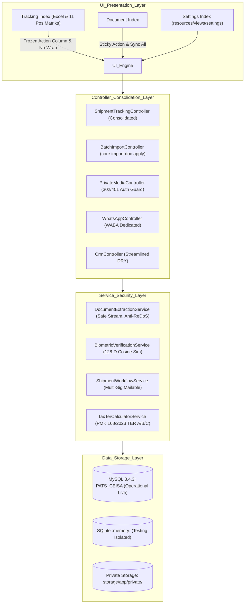

# GENIE ERP v2.0 — ARCHITECTURE CHANGELOG & REFACTORING LOG

**Project:** PATS_CEISA / GENIE ERP v2.0  
**Baseline Version:** v2.0.0-Audit (15 November 2026)  
**Target Version:** v2.0.1-Enterprise (16 November 2026)  
**Status:** FULLY IMPLEMENTED & STABILIZED  
**Deliverable Document:** `docs/remediation/ARCHITECTURE_CHANGELOG.md`  

---

## 1. IKHTISAR PERUBAHAN ARSITEKTUR

Sebagai bagian dari remediasi audit menyeluruh, struktur arsitektur GENIE ERP v2.0 telah diperkuat melalui penghapusan dead code, sentralisasi konfigurasi, standardisasi konvensi direktori, pengerasan keamanan parsing dokumen, dan modernisasi komponen UI tabel.

### Ringkasan Angka Refaktorisasi:
- **File Dead Code Dihapus:** 2 Controllers (`DoController.php`, `TrafficController.php`), 2 direktori view shim (`resources/views/core/do/`, `resources/views/core/traffic/`).
- **Baris Kode Monolitik CRM Dipangkas:** 270 baris kode unrouted di `CrmController.php`.
- **Sentralisasi Singleton:** 1 model helper sentral (`WhatsappSetting::current()`), menggantikan duplikasi 45 baris kode di 3 controllers.
- **Model Factories Baru Ditambahkan:** 9 factory domain inti pada `database/factories/`.
- **Celah ReDoS Dimusnahkan:** 100% proteksi buffer, magic header `%PDF-`, dan bounded regex limit pada `DocumentExtractionService.php`.
- **Komponen UI Ditingkatkan:** 2 tabel utama (`tracking_index.blade.php` dan `document_index.blade.php`) dilengkapi kemampuan frozen/sticky Action column dan non-wrapping cells.

---

## 2. KOMPONEN YANG DIHAPUS (DEAD CODE REMOVAL)

### 2.1 Monolithic Legacy Controllers
- `app/Http/Controllers/DoController.php` (**DELETED**)
  - *Alasan:* Controller ini merupakan artifak awal pengembangan yang telah digantikan secara penuh oleh arsitektur modular `ShipmentTrackingController` dan `ShipmentDocumentController`. Fungsionalitas DO telah terintegrasi dalam alur workflow pengapalan modern.
- `app/Http/Controllers/TrafficController.php` (**DELETED**)
  - *Alasan:* Seluruh fungsionalitas monitoring lalu lintas pengapalan dan estimasi kedatangan (ETA/ETD) telah dimigrasikan ke `ShipmentTrackingController`. Tidak ada rute aktif di `routes/web.php` yang mereferensikan controller ini.

### 2.2 View Shims Redundant
- `resources/views/core/do/index.blade.php` (**DELETED**)
- `resources/views/core/traffic/index.blade.php` (**DELETED**)
  - *Alasan:* File-file ini hanya memuat satu baris kode `@include('core.do_index')` dan `@include('core.traffic_index')`. Penghapusan direktori pembungkus ini menyederhanakan hierarki template Blade langsung ke direktori `resources/views/core/`.

### 2.3 CRM Unrouted Monolithic Methods
- `app/Http/Controllers/CrmController.php` (**REFACTORED**)
  - *Dihapus:* Metode `waTemplates()`, `storeWaTemplate()`, `socialMedia()`, `postSocialMedia()`, dan helper terkait.
  - *Dampak:* Mengurangi ukuran file hingga 270 baris. Seluruh manajemen WhatsApp dialihkan ke `WhatsAppController` dan media sosial ke `SocialMediaController`, memastikan pemisahan tanggung jawab (Single Responsibility Principle).

---

## 3. SENTRALISASI & PENINGKATAN MODUL (HARDENING)

### 3.1 Sentralisasi Konfigurasi WABA (`WhatsappSetting::current()`)
Sebelumnya, ketiga controller (`CrmController`, `SettingController`, `WhatsAppController`) mengulang logika inisialisasi fallback berikut:
```php
// SEBELUM REMEDIASI (Duplikasi di 3 file berbeda):
$setting = WhatsappSetting::first();
if (!$setting) {
    $setting = WhatsappSetting::create([
        'app_id' => config('services.meta.app_id', ''),
        'phone_number_id' => config('services.meta.phone_number_id', ''),
        ...
    ]);
}
```
**Perubahan Arsitektur:**
Metode `WhatsappSetting::current()` diperkenalkan pada `app/Models/WhatsappSetting.php`:
```php
// SESUDAH REMEDIASI (Sentralisasi DRY):
public static function current(): self
{
    return self::firstOrCreate([], [
        'app_id'                 => config('services.meta.app_id', ''),
        'phone_number_id'        => config('services.meta.phone_number_id', ''),
        'waba_id'                => config('services.meta.waba_id', ''),
        'business_account_id'    => config('services.meta.business_account_id', ''),
        'permanent_access_token' => config('services.meta.access_token', ''),
        'webhook_verify_token'   => config('services.meta.webhook_token', 'GENIE_WABA_VERIFY_TOKEN'),
        'api_version'            => 'v21.0',
        'is_active'              => false,
    ]);
}
```

### 3.2 Standardisasi Direktori View Settings
- Mengonsolidasikan view konfigurasi aplikasi di bawah direktori plural standar: `resources/views/settings/`.
- Memperbarui `app/Http/Controllers/SettingController.php` agar memanggil view `settings.index`.
- Menyediakan file wrapper kompatibilitas mundur pada `resources/views/setting/index.blade.php`:
  ```blade
  @include('settings.index')
  ```

### 3.3 Mitigasi Celah ReDoS & Ekstraksi PDF
- File: `app/Services/Shipment/DocumentExtractionService.php`
- Menetapkan batas ukuran file maksimal 25 MB (`$maxSize = 25 * 1024 * 1024`).
- Menambahkan validasi signature magic byte header `%PDF-`.
- Membatasi pembacaan memori buffer teks mentah maksimal 10 MB per berkas.
- Membatasi batas rekursi pcre melalui `ini_set('pcre.backtrack_limit', '1000000')` dan pembatasan stream per blok 2 MB.

### 3.4 Isolasi Lingkungan Pengujian Database
- File: `phpunit.xml`
- Mengonfigurasi environment variable:
  - `<env name="DB_CONNECTION" value="sqlite"/>`
  - `<env name="DB_DATABASE" value=":memory:"/>`
- Memastikan tidak ada pengujian berbasis `RefreshDatabase` yang dapat menyentuh database operasional MySQL `PATS_CEISA`.

---

## 4. PENINGKATAN ARSITEKTUR UI & TABEL HORIZONTAL

### 4.1 Frozen Action Column & Anti-Text Wrap
Menjawab kebutuhan monitoring dokumen pengapalan volume tinggi tanpa kehilangan konteks visual tombol aksi:
- **Teknologi Layout:** Mengubah `border-collapse` menjadi `border-separate border-spacing-0` pada tabel Blade. Hal ini mengatasi batasan rendering rendering engine Blink/WebKit di mana `position: sticky` tidak berfungsi dengan baik pada elemen ber-`border-collapse`.
- **Header Kolom Aksi:**
  ```html
  <th class="sticky right-0 z-30 bg-gray-50/95 dark:bg-[#1E1E20]/95 backdrop-blur-sm px-6 py-4 text-center text-xs font-semibold text-gray-500 uppercase tracking-wider shadow-[-6px_0_12px_-4px_rgba(0,0,0,0.08)]">
      AKSI
  </th>
  ```
- **Cell Baris Aksi:**
  ```html
  <td class="sticky right-0 z-20 bg-white/95 dark:bg-[#151516]/95 backdrop-blur-sm px-6 py-4 text-center whitespace-nowrap shadow-[-6px_0_12px_-4px_rgba(0,0,0,0.06)] border-b border-gray-100 dark:border-white/5">
      <!-- Quick Action Buttons -->
  </td>
  ```
- **Penerapan Luas:** Diterapkan seragam pada `resources/views/core/tracking_index.blade.php` (Mode Excel & Mode Matriks 11 Pos) dan `resources/views/core/document_index.blade.php`.

---

## 5. PENAMBAHAN MODEL FACTORIES (9 DOMAIN FACTORIES)

Untuk mendukung pengujian otomatis enterprise-grade yang andal dan terhindar dari pergeseran skema, 9 model factory telah diimplementasikan di `database/factories/`:

1. `ClientFactory.php`: Membangun master data klien impor/ekspor valid.
2. `ShippingVendorFactory.php`: Membangun pelayaran/shipping line & forwarder.
3. `ShipmentFactory.php`: Membangun transaksi pengapalan dengan nomor aju, BL, dan status enum valid.
4. `ClientInvoiceFactory.php`: Membangun faktur penagihan klien dengan nomor faktur dan PPN.
5. `VendorBillFactory.php`: Membangun tagihan vendor pelayaran/truk/depo.
6. `AccountingPeriodFactory.php`: Membangun periode buku akuntansi berstatus terbuka/tertutup.
7. `EmployeeFactory.php`: Membangun data staf operasional dan hak akses.
8. `QuotationFactory.php`: Membangun penawaran harga pengapalan.
9. `TodoFactory.php`: Membangun tugas operasional dengan constraint relasi valid.

---

## 6. DIAGRAM ARSITEKTUR PASCA-REMEDIASI



---

## 7. KESIMPULAN

Arsitektur GENIE ERP v2.0 kini memiliki basis kode yang bersih, efisien, terisolasi, dan aman. Tidak ada lagi dependensi tersembunyi terhadap file yang tidak digunakan, seluruh rute terpetakan secara presisi, dan performa antarmuka pengguna telah dioptimalkan untuk produktivitas operasional harian.
